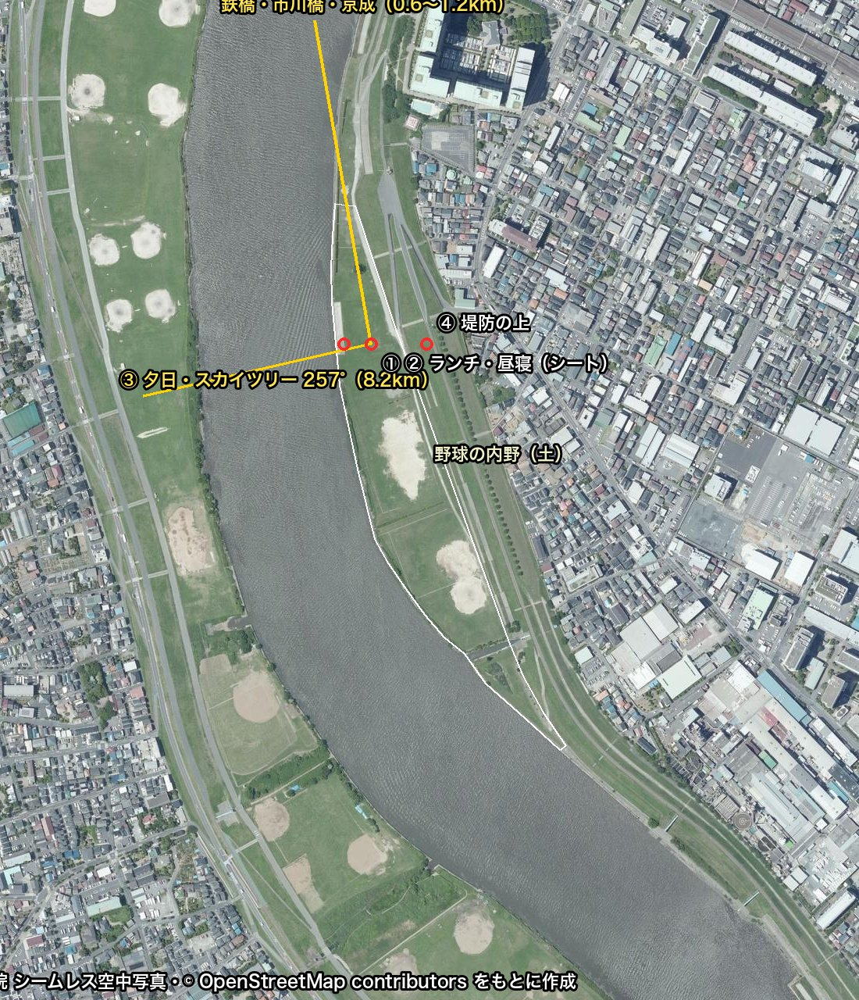
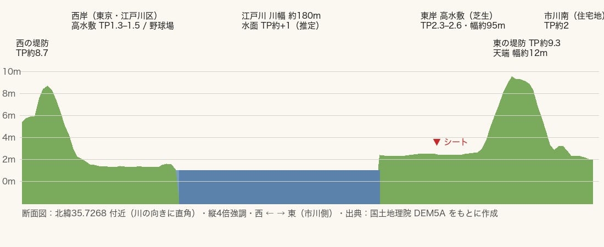

# 江戸川河川敷ピクニック（市川）— 地形分析・詳細設計・実装計画

企画提案書（`docs/江戸川周辺_身軽ピクニック企画提案書_改訂版.pdf`）の場所①「江戸川河川敷緑地（市川エリア）」を、実際の地形データをもとにドット絵の歩ける場面として再現するための設計書です。

- 作成日：2026-10-18
- 対象：新しい場面 `edogawa.html`（今の `picnic.html` は「架空の川辺」として残す）
- 関連：[SPEC.md](SPEC.md)（今のエンジンの仕様）

---

## 1. 結論（要点）

| 項目 | 内容 |
|---|---|
| 場所 | 江戸川河川敷緑地（市川市市川南、OSM way 1150931070）。JR 市川駅から南西へ約 0.9 km |
| シートの位置 | 北緯 35.72707・東経 139.89870（北側の芝生。水際から約 46 m、堤防の下から約 41 m） |
| 地形 | 川幅 約 180 m。市川側の河川敷は高さ TP 2.3〜2.6 m・幅 約 95 m のほぼ平らな芝生。堤防の上は TP 約 9.3 m（河川敷より約 7 m 高い） |
| 向き | 川は北北西〜南南東に流れる（上流が方位 338°）。シートから見ると、川の向こう（西）が東京側 |
| 一番の見せ場 | **10月中旬の日の入り（16:55ごろ、方位 258°）がスカイツリー（方位 257°・8.2 km）とほぼ重なる**。川面に夕日の光の道ができ、塔の影絵の横に日が沈む |
| 遠くに見えるもの | 北（右手）0.6〜1.2 km に JR 総武線の鉄橋・市川橋・京成線の鉄橋。北東に国府台の台地（里見公園）。送電線の鉄塔 |
| 作り方 | 近く（約 120 m 四方）は実測の断面をもとに作り込み、中くらいの距離は標高データをそのまま使い、遠くは方位を合わせた影絵で描く |
| 作業量の目安 | 6 段階・およそ 11〜12 日分（[8章](#8-実装計画)） |



---

## 2. 使ったデータ

| データ | 中身 | 使い方 | 出典の書き方 |
|---|---|---|---|
| 国土地理院 標高タイル DEM5A（z15、1 画素 約 3.9 m） | 地面の高さ（TP、東京湾の平均海面からの高さ）。水面は「値なし」 | 断面の測定、中くらいの距離の地形 | 「国土地理院 基盤地図情報 数値標高モデル（DEM5A）をもとに作成」 |
| 国土地理院 シームレス空中写真（z17、1 画素 約 1 m） | 航空写真 | 芝生・土の内野・道・並木・護岸の位置を読み取る（下絵用。画面には出さない） | 「国土地理院 シームレス空中写真をもとに作成」 |
| OpenStreetMap（Overpass API） | 公園の範囲、野球場、橋、鉄道、送電線と鉄塔、道 | 物の配置と名前 | 「© OpenStreetMap contributors」（ODbL） |

調べた範囲：北緯 35.712〜35.740・東経 139.880〜139.912（約 2.9 km × 3.1 km）。取得と変換のスクリプトは `tools/geo/` にあります（使い方は [tools/geo/README.md](../tools/geo/README.md)）。

---

## 3. 地形の分析

### 3.1 断面（川の向きに直角、シートの位置付近）



川の向きに沿って 80 m おきに 8 本の断面を取りました。どの断面もほぼ同じ形です。

| 部分 | 測った値 | 場面での扱い |
|---|---|---|
| 西の堤防の上（東京側） | TP 8.5〜8.7 m | 遠景（形だけ） |
| 西の河川敷 | TP 1.3〜2.0 m、幅 80〜150 m。野球場が並ぶ | 遠景：芝生と土の内野、バックネット |
| 川（水面） | 幅 約 180 m（178〜186 m）。標高データには値がない | 水面の高さは **TP +1.0 m と仮定**（下流の行徳可動堰でせき止められた水位。7章の確認事項） |
| 東の水際 | 河川敷の縁 TP 2.2〜2.4 m → 水面との段差 約 1.2〜1.4 m | 護岸：写真では水際に沿って細い舗装の帯が見える。芝の斜面＋コンクリートブロックの足元 |
| 東の河川敷（主な舞台） | TP 2.3〜2.6 m、幅 約 95 m。川から堤防に向けてゆるく上がる（傾き 0.3% 程度） | 歩ける範囲。実際はほぼ平らなので、今の picnic.html の「坂」は使わない |
| 堤防の川側の斜面 | 高さ 約 6.5 m を 約 25〜30 m で上がる（勾配 およそ 1:4） | 斜面は芝。斜めに上がる坂道（写真の白い斜線）を道として作る |
| 堤防の上 | TP 9.0〜9.5 m、幅 約 12 m（道路と歩道） | 歩ける。ここからの見晴らしを視点④に |
| 堤防の町側 | TP 2.8〜3.0 m の段（側帯）を経て住宅地 TP 約 2 m。並木が 1 列 | 遠景：並木と家並み |

### 3.2 航空写真から読み取ったこと

- 公園の範囲は細長い三日月形：長さ 約 730 m、面積 約 5.3 ha。
- 芝生の中に**野球の内野（土）が 3 つ**ある。北の内野の北側と川側が、広く開けた芝生。シートはここに置く。
- 芝生を斜めに横切る舗装の道が 1 本。堤防へ上がる坂道が 2 本。
- 堤防の町側に並木が 1 列（約 300 m）。芝生の中には、シートの北 約 95 m に**単独の木が 1 本**（樹冠の半径 約 5 m）。ほかに水際の茂みが 2〜3 か所。
- 北の端に駐車場と、堤防の外に大きな建物（高層の団地）。
- 対岸（東京側）は野球場が続き、その奥の堤防の向こうに家並み。

### 3.3 遠くに見えるもの（シートからの方位と距離）

方位は北を 0° として時計回り。

| 物 | 方位 | 距離 | 見え方 |
|---|---|---|---|
| 東京スカイツリー（高さ 634 m） | 257° | 8.2 km | 見かけの高さ 約 4.4°。川の向こうの真正面より少し右 |
| JR 総武線の鉄橋（緩行線・快速線の 2 本並び、長さ 約 415 m） | 340°〜10° | 0.6〜0.8 km | 右手（上流）を横切る鉄橋。電車が通る |
| 市川橋（国道 14 号・千葉街道、2 本） | 347°〜13° | 0.8〜0.9 km | 鉄橋のすぐ奥の桁橋 |
| 京成本線の鉄橋 | 348°〜18° | 1.1〜1.2 km | さらに奥 |
| 国府台（里見公園）の台地 | 15° 付近 | 1.5 km | 標高 約 20 m の緑の高台。鉄橋の奥の背景 |
| 送電線の鉄塔（小松川線 154 kV ほか） | 10°（280 m）、315°（0.7〜0.8 km） | — | 川を斜めに渡る送電線。空に線が入る |
| 市川駅周辺の高い建物 | 65° 付近 | 0.9 km | 堤防越しに少し見える |

### 3.4 太陽（2026年10月18日、シートの位置）

| 時刻 | 高さ | 方位 | 提案書の流れ |
|---|---|---|---|
| 11:45 | 44.7° | 187° | 着いてシートを広げる |
| 12:00 | 44.2° | 192° | ランチ（スープ） |
| 13:00 | 39.7° | 211° | 昼寝 |
| 14:00 | 32.0° | 227° | |
| 15:00 | 22.3° | 239° | 撤収 |
| 16:00 | 11.3° | 250° | |
| 16:30 | 5.5° | 254° | |
| 16:54 | 0.8° | 258° | 日の入り直前：スカイツリーの真横 |

- 昼は南の空から、川の上流側を除くほぼ全体が明るい順光〜横からの光。
- 午後は太陽が川の向こう（西）に回るので、川を見ると**逆光になり、水面がきらめく**。今の picnic.html で太陽を北側に置いて作った「逆光の絵」が、ここでは本物の太陽の位置で自然にできる。

---

## 4. 場面の範囲と座標

### 4.1 座標の決め方

- 原点：シートの位置（35.72707, 139.89870）。地面の高さ TP 2.5 m を y = 0 とする。
- 1 単位 = 1 m。
- **−z が上流（方位 338°）、+x が町側（方位 68°）、−x が川の向こう（方位 248°）**。今の picnic.html と同じく「川は −x 側、陸は +x 側、川は z 方向に流れる」ので、カメラ操作や視点の作りをそのまま使える。
- 緯度経度から場面の座標への変換は、`tools/geo/build_scene.py` で一度だけ計算して `scene.json` に書き込む（実行時に地図の計算はしない）。

### 4.2 3つの距離帯

| 帯 | 範囲 | 作り方 | 影 |
|---|---|---|---|
| 近景（歩ける） | x −45〜+70、z −60〜+60（約 115 m × 120 m）：水際から堤防の上まで | 測った断面をもとにした「断面の型」で地形を作る（下記）。地面の種類（芝・土・舗装・護岸）を 1 m ごとの画像で塗り分ける | あり（今の影の仕組み、範囲だけ広げる） |
| 中景 | 約 1.2 km × 1.2 km：川・対岸の河川敷と堤防・鉄橋まで | DEM5A をそのまま粗いメッシュ（4 m 間隔）にする。色は地面の種類ごとに単色 | なし |
| 遠景 | それより遠く | 方位に合わせて並べた影絵の板（家並み・スカイツリー・国府台・高い建物）。霧で溶かす | なし |

**近景の「断面の型」について**：DEM5A は 1 画素が約 4 m なので、水際の段差や堤防の角がなまってしまいます。近景だけは、測った値から決めた断面の形（水際の段差 1.3 m → ゆるい芝生 → 堤防の斜面 1:4 → 幅 12 m の上面 → 町側の斜面）を川の向きに沿って伸ばします。川の曲がり具合と河川敷の幅は、DEM の値から距離ごとに読み取ります。

### 4.3 歩ける範囲

- 芝生、土の内野、道、坂道、堤防の上。
- 水には入れない（今の当たり判定と同じく、水際で止まる）。
- 堤防の斜面は測ると 1:4（約 14°）で、人が歩ける傾きなので歩けるようにする。坂道（舗装）は地面の色として描くだけで、高さは削らない（P0 で決定）。
- 範囲が今の約 4 倍に広がるので、タップで歩く距離の上限と歩く速さを見直す（遠くをタップしたら少し早歩きにする）。

---

## 5. 詳細設計

### 5.1 データの流れ

```
tools/geo/fetch_data.py ─▶ tools/geo/cache/ ─▶ tools/geo/build_scene.py ─▶ scenes/edogawa/
  （標高・OSM・空中写真）                        （check_scene.py で確認）    ├─ scene.json       … 座標の決め方・断面・水際・木・ランドマーク・視点・太陽
                                                                            ├─ mid_height.png   … 中景の高さ（4 m 間隔、385×449）。R*256+G = (TP+10)*100、B = 地面の種類
                                                                            ├─ near_height.png  … 近景の高さ（1 m 間隔、177×193）。同じ符号化
                                                                            ├─ ground.png       … 近景の地面の種類（1 m 間隔、色で種類を表す）
                                                                └─ ATTRIBUTION.md
```

- 取ってきた生データ（標高タイル・OSM・写真）は `tools/geo/cache/` に置き、配布物には含めない。
- `ground.png` は、OSM の範囲と写真を見ながら手で直せるように、普通の画像として保存する（内野の形・道・護岸の帯など）。
- `scene.json` の例：

```json
{
  "origin": { "lat": 35.72707, "lon": 139.89870, "tp": 2.5, "upstreamBearing": 338 },
  "water": { "level": -1.5, "shore": [[-34, -60], [-35, -20], [-36, 20], [-38, 60]] },
  "section": { "bankDrop": 1.3, "floodplainRise": 0.003, "leveeToe": 60, "leveeSlope": 4.0, "crownWidth": 12, "crownHeight": 6.9 },
  "landmarks": [
    { "id": "skytree", "bearing": 257, "dist": 8167, "height": 634, "kind": "tower" },
    { "id": "jr-bridge", "from": [-230, -620], "to": [190, -560], "kind": "truss", "tracks": 2 },
    { "id": "ichikawa-bridge", "from": [-240, -820], "to": [200, -760], "kind": "girder" }
  ],
  "props": [ { "kind": "infield", "at": [18, 120], "r": 22 }, { "kind": "lone-tree", "at": [-6, -24] } ]
}
```

（数値は例。正しい値は build_scene.py が計算する）

### 5.2 エンジンに足すもの

今の共通エンジン（`engine/`）に、場面に依存しない形で足します。

| 新しい部品 | ファイル | 内容 |
|---|---|---|
| 高さ画像からの地形 | `engine/terrain.js` | `createHeightTerrain({ heightUrl, groundUrl, palette, near, far })`。近景と中景の 2 枚のメッシュ。`heightAt(x, z)` は近景→中景の順に調べる（プレイヤーと物の配置で使う）。地面の種類ごとに 3 色（RAMP）と細かい模様（芝の筋・土の粒）を付ける |
| 水際の形を自由にした水面 | `engine/water.js` に追加 | 今は川の中心と幅を式で渡している。これを「水際の線」（点の並び）でも渡せるようにする。川は幅 180 m と広く濁っているので、色を「江戸川の色」（緑がかった灰色、透明度 約 1 m）にし、川底の光の模様は水際の数 m だけにする |
| 実際の太陽の位置 | `engine/sun.js`（新規）と `engine/time-of-day.js` | `sunPosition(date, lat, lon)` で高さと方位を計算し、場面の座標に回して渡す。今の `sunZ` のような調整用の値は使わない。月も同じ方法で計算 |
| 遠景の影絵 | `engine/backdrop.js`（新規） | 方位・距離・高さを受け取って、見かけの大きさが正しくなる位置（約 400 m 先）に影絵の板を立てる。霧の色に溶かし、時間帯で色を変える。夕方は太陽の側の影絵を暗く、輪郭を明るくする |
| 長い物の簡易な作り方 | `engine/structures.js`（新規） | トラス鉄橋（三角の骨組みを繰り返す）、桁橋、鉄塔と送電線（たるんだ線）、フェンス、バックネットを、数値から組み立てる |
| 範囲が広いときの影 | `engine/pixel-renderer.js` | 影を付ける範囲をカメラの周り（約 60 m）に限って追いかける。今の影の細かさを保つ |

### 5.3 場面 `edogawa.html` の中身

**地面と水**
- 芝生：10月中旬の色。緑に少し黄色が混じる。所々に踏まれて薄くなった所。
- 土の内野 3 つ：薄いベージュ。バックネットと白線は控えめに。
- 道：舗装の明るい灰色。堤防へ上がる坂道 2 本。
- 水際：芝の斜面とブロックの足元。水際にススキとオギの群れ（風で揺れる）。
- 堤防：川側の斜面は芝、上は道路と歩道（舗装）。町側の斜面に並木。
- 川：幅 180 m。今の水面の仕組み（波・きらめき・映り込み・屈折）をそのまま使い、色と透明度を江戸川に合わせる。午後は西に回った太陽で光の道ができる。

**遠景（右手＝上流側から）**
1. JR 総武線の鉄橋：トラス 2 本が並ぶ。電車（黄色い帯の各駅停車／青と白の快速）が数分おきに渡る。
2. 市川橋：灰色の桁橋。車の流れを光の粒で。
3. 京成線の鉄橋。
4. 国府台の緑の台地（里見公園）。
5. 送電線の鉄塔と、川を斜めに渡る送電線。
6. 対岸：野球場（土の内野・バックネット）、堤防、家並み、遠くのビル群。
7. スカイツリー：川の向こう、少し右。昼は淡い水色の影絵、夕方は逆光の黒い影絵。

**ピクニックの道具（提案書の持ち物から）**

| 道具 | 大きさの目安 | 動き・見せ方 |
|---|---|---|
| レジャーシート 200 × 140 cm | 2.0 m × 1.4 m（今の正方形 2.8 m から変更） | 平らな芝に置くので、坂に食い込む問題はもう起きない |
| スープジャー 400 ml | 高さ 16 cm | ふたを開けると湯気（粒子、ゆっくり上がって風で流れる） |
| 二重構造のカップ 2 つ | 高さ 10 cm | 湯気 |
| ジュートのトートバッグ | 40 cm | 麻の粗い模様 |
| エアクッションと枕 | 40 cm 角 | 昼寝の視点で頭の位置 |
| 保冷のランチバッグ、パン | — | — |
| 小さなテーブル（任意） | 30 cm | — |

今の picnic.html のピッチャー・グラス・ランタン・帽子・本は持ってこない（提案書の「身軽」に合わせる）。

**生き物と動き（10月中旬）**
- 赤とんぼ：昼〜夕方、低く飛ぶ（今の花びらの代わり）。
- トビ：空の高い所で輪を描く（昼寝の視点で見える）。
- ススキの穂と芝の揺れ：川風で（今の草の揺れの仕組み）。
- 鉄橋を渡る電車、市川橋の車、川を行く小さな船（まれに）。
- 夕方：秋の虫の声（音）。ホタルは 10 月にはいないので出さない。
- 人：遠くの対岸で野球やジョギングをする小さな人影を数人（任意、段階 P3 で判断）。

**時間帯**
- 一日の流れ：11:45 着 → 12:00 ランチ → 13:00 昼寝 → 15:00 撤収（提案書）→ おまけで 16:55 日の入り → 17:20 夕焼けの終わり。
- 太陽は 3.4 の計算どおり。空と光の色の段階（今の時間帯の色表）は、10 月の短い午後に合わせて作り直す（日の入りが 16:55 と早く、15 時でもう光が黄色くなる）。
- 雲：秋晴れ。高い所のうろこ雲（巻積雲）を薄く。

### 5.4 視点（ボタン）

| ボタン | 時刻 | 位置と向き | 狙い |
|---|---|---|---|
| 🍲 ランチ | 12:00 | シートに座った目の高さ（0.75 m）、方位 285° を向く | 手前にスープジャーと湯気、奥に広い川と右手の鉄橋。提案書の写真 1 に近い構図 |
| 😴 昼寝 | 13:00 | シートに寝ころび、空を見上げる（上 60°） | 空とうろこ雲、輪を描くトビ。画面の端で芝とススキが揺れる |
| 🌇 夕日 | 16:50 | 水際（シートから西へ約 35 m）、方位 257° を向く | スカイツリーの横に沈む夕日と、川面の光の道。今の picnic.html の夕日の視点に当たる |
| 🌉 鉄橋 | 15:00 | 堤防の上、北を向く | 上流の鉄橋 2 本と市川橋、国府台。電車が通る |

6 秒ループの書き出しは今のまま使える。電車が通る絵は 6 秒では途切れるので、電車が写らない時間を選ぶか、「12 秒ループ」を書き出しの選択肢に足す（段階 P5 で判断）。

### 5.5 見た目の調整

- 色の段階（32 段階）と素材ごとの 3 色の仕組みはそのまま。秋の色に合わせて、芝・土・ススキ・川の 3 色を新しく決める。
- 遠景は霧と空の色に寄せて、近景との奥行きをはっきりさせる（今の `fogSkyMix`）。
- 空気中の光の筋は、遮る物（木）が少ないので弱めにする。夕日のときだけ、鉄橋や鉄塔の影から少し出す。
- 木漏れ日は、単独の木（シートの北 約 95 m）と町側の並木だけで使う。シートは日なたにある（提案書の「青空の下で昼寝」に合わせる）。

### 5.6 速さの目安

| 項目 | 目標 |
|---|---|
| 1 コマの CPU 時間 | 4 ms 以下（今の picnic は約 2.3 ms） |
| 地形の三角形 | 近景 約 3 万、中景 約 9 万（300 × 300） |
| 影を付ける範囲 | カメラの周り 60 m |
| スマホ | 草の数を減らす（今の仕組み）。遠景の影絵は 1 枚の画像にまとめる |
| 読み込むデータ | scene.json＋高さ 2 枚＋ground.png で 1 MB 以下（P0 の出力は 約 210 KB） |

---

## 6. 出典の表示とライセンス

- 画面のメニューの中と、書き出した画像を載せるページに次を表示する：
  - 「地形：国土地理院 基盤地図情報 数値標高モデル（DEM5A）を加工して作成」
  - 「配置の参考：国土地理院 シームレス空中写真」
  - 「地図データ：© OpenStreetMap contributors」
- OSM から作った `scene.json` はデータベースとして ODbL の対象になる。公開するなら同じ条件で公開できるようにしておく（`scenes/edogawa/ATTRIBUTION.md` に書く）。
- 航空写真の画像そのものは配布物に入れない（下絵として見るだけ。`docs/edogawa/site_map.jpg` は設計の説明用で、出典を書いてある）。
- スカイツリーや鉄道の車両は、形と色の特徴だけを使った簡略な影絵にする（ロゴや社名は描かない）。

---

## 7. 決まっていないこと・確認したいこと

| 項目 | 今の仮の値 | 確認の方法 |
|---|---|---|
| 水面の高さ | TP +1.0 m | 国土交通省 水文水質データベースの江戸川の観測所（市川付近）の平常時の水位。違っても水際の段差の見え方が少し変わるだけ |
| 単独の木 | **確認済み**：シートの北 約 95 m（x 24.8, z −91.9）、半径 約 5 m | — |
| 水際の護岸 | 写真から幅 2〜6 m のブロックの斜面。シートの西に長さ 約 70 m の舗装の広場が水際にある | 素材の見た目は現地の写真で確認 |
| 鉄橋の形 | トラス（三角の骨組み） | 写真で確認。総武線の江戸川橋梁は 2 本の線が並ぶ。細部は簡略化する |
| 人を出すか | 出さない（遠くの小さな人影だけ任意） | 段階 P3 で見た目を見て決める |
| 今の picnic.html との関係 | 架空の川辺として残す。入口ページに場面を 1 つ追加 | — |

---

## 8. 実装計画

| 段階 | 内容 | できあがりの確認 | 目安 |
|---|---|---|---|
| **P0 データ** ✅ | `tools/geo/` を整理（取得・キャッシュ・`build_scene.py`）。`scenes/edogawa/` に scene.json・height.png・ground.png・ATTRIBUTION.md を出力。ground.png を写真に合わせて手直し | 出力した画像を写真と重ねてずれが 2 m 以内。断面が 3.1 の値と合う | 1.5 日 |
| **P1 エンジン** ✅ | `terrain.js`（近景＋中景、`heightAt`）、水際の線で水面を作る、`sun.js`（実際の太陽の位置）、`backdrop.js`、影の範囲を追いかける。ピクニックと街で今までどおり動くか確かめる | 今の 2 つの場面の見た目が変わらない。テスト用の平らな場面で地形と水が出る | 2.5 日 |
| **P2 場所の組み立て** ✅ | `edogawa.html` を作る。地面・水際・堤防・坂道・内野・並木。`structures.js` で鉄橋 2 本・市川橋・京成の鉄橋・鉄塔と送電線。対岸と遠景の影絵、スカイツリー | 4 つの視点で、方位・見かけの大きさが計算どおり（スカイツリーの方位 ±1°）。歩いて堤防の上まで行ける | 3 日 |
| **P3 道具と生き物** ✅ | シート 200×140、スープジャーと湯気、カップ、トート、クッション、パン。赤とんぼ、トビ、ススキ、電車と車 | 提案書の持ち物が全部ある。湯気がループの継ぎ目で途切れない | 2 日 |
| **P4 絵作り** ✅ | 10 月の時間帯の色表、秋の 3 色、霧と遠景の色、うろこ雲、夕日の光の道。視点ボタン 4 つ。音（川風・虫・電車の音を遠く） | ランチと夕日の絵を、提案書の写真 1 と見比べて方向性が合う | 1.5 日 |
| **P5 仕上げ** ✅ | 書き出し（必要なら 12 秒ループ）、スマホ確認、速さの測定、入口ページ・README・SPEC の更新、出典の表示 | 1 コマ 4 ms 以下、スマホで 30 fps 以上、ループの継ぎ目の差が今と同じくらい | 1 日 |
| | | **合計** | **約 11.5 日** |

進め方：各段階の終わりに画面で確認してもらい、次に進みます。最初の P0 と P1 は見た目が大きく変わらないので、P2 の途中（地面と水と遠景が出た時点）で一度スクリーンショットを見てもらうのがよいと考えています。

---

## 9. P0 の結果（2026-10-18）

`python3 tools/geo/build_scene.py` で `scenes/edogawa/` を作りました（約 210 KB）。確認は `python3 tools/geo/check_scene.py`。

| 確認 | 結果 | 目標 |
|---|---|---|
| 護岸の上の端と、写真で芝が始まる位置 | ずれの中央値 0.39 m、92% が 2 m 以内（60 行。水際の広場の 37 行は除く） | 2 m 以内 ✅ |
| 断面の型と標高の差（RMS） | 河川敷 0.08 m、堤防の斜面 0.08 m、堤防の上 0.22 m | 3.1 の値と合う ✅ |
| 原点の断面 | 水際 x = −45.9、河川敷 TP 2.64、堤防の下 x = 41、上 x = 68〜80（幅 12.7 m）TP 9.40、斜面 1:4.0 | 3.1 と一致 ✅ |
| ランドマーク | 橋 4（JR 総武線の緩行線・快速線、市川橋、京成線）、鉄塔 22、送電線 5、高い建物 31、遠景 4（スカイツリー 方位 256.6°・8.17 km ほか） | — |
| 木 | 6（単独の木 1、水際の茂み、並木の一部）＋ OSM の並木 1 列 | — |

設計からの変更・わかったこと
- 取得は 1 本のスクリプト（`fetch_data.py`）にまとめた。高さの画像は近景用と中景用の 2 枚に分けた。
- 標高データでは、川が橋のところで分かれる。そのため「川とつながった値なしの画素」ではなく「値なしの大きな塊」を水とした。
- 護岸の幅は標高データではわからない（5 m の格子より細い）。空中写真で芝が始まる位置から読んだ。
- 堤防の斜面は 1:4 で歩ける傾きなので、歩けるようにする（4.3 を変更）。
- 空中写真は全体に彩度が低く、土の内野と舗装の道がどちらも明るい灰色に写る。そこで形で分けた（幅 7 m 以上の塊は土、細いものは道）。シートの東を通る広い道は「土」になった（実際も砂利の道に見える）。
- 中景の野球場は、OSM の範囲全体を「野球場」として塗っている。土の内野の形は P2 で場面側で描く。

## 10. P1 の結果（2026-10-18）

エンジンに次を足しました。確認用のページは `dev/edogawa_p1.html`（4 つの視点ボタンと時刻のスライダー）。

| 部品 | 内容 |
|---|---|
| `engine/sun.js` | 太陽（NOAA の近似式）と月（簡易式、満ち欠けつき）。10/18 の日の出 5:48・南中 11:25・日の入り 17:02。Python の計算と一致 |
| `engine/time-of-day.js` | `sunPath` で実際の太陽・月を使う。色の表は日の出・日の入りに合わせて読み替える。`setShadowCenter` で影の範囲をカメラに追従（影の格子に揃えるので動いてもちらつかない） |
| `engine/terrain.js` | 近景（1 m、177×193）と中景（8 m に間引き）。近景の縁 6 m で中景になめらかにつなぐ。地面の種類ごとの 3 色と模様（芝の筋・土の粒・舗装の目地・護岸のブロック・アスファルト）でテクスチャを焼く |
| `engine/water.js` | 水際の形（両岸の水際で囲んだ多角形）、深さマップの範囲を別に指定、濁り（`clarity`）、遠くの波で反射を乱さない（`waveFade`） |
| `engine/backdrop.js` | スカイツリー（方位 256.6°・8.2 km）、国府台、対岸の家並み、市川の家並みを、見かけの大きさを合わせて立てる。逆光のときは暗い影絵 |
| `engine/sky.js` | 空の球の半径と雲の大きさを指定できるように |

確認したこと
- 今の 2 つの場面（ピクニック・街）は見た目が変わらず、エラーもない（追加した設定はすべて「指定しなければ今までどおり」）。
- 16:50 の夕日の視点で、太陽がスカイツリーのすぐ横に沈み、川面に光の道ができる。
- 1 コマの CPU 時間 0.4〜1.3 ms（目標 4 ms 以下）。

P2 以降への申し送り
- **ランチの視点から川がほとんど見えない**：河川敷（TP 2.6）は水面（TP 1.0）より 1.6 m 高く、シートは水際から 46 m 離れているので、座った目の高さ（0.75 m）では川が細い帯にしか見えない（現地でもそうなるはず）。提案書の写真 1 のように川を見せるなら、シートを水際から 15〜20 m の所へ寄せるか、視点を立った高さにする。P2 で決める。
- 遠くの水面に、波の格子による同心円のもようが出る。P4 で遠くの波を弱める／細かさを変える。
- 夕方 16:50 で星が出始める（色の表の読み替えで「夜らしさ」が早く上がる）。P4 の 10 月用の色の表で直す。
- 地面のテクスチャは、まだら模様が 1 m 角に見えて大味。P4 で調整する。

## 11. P2 の結果（2026-10-18）

`edogawa.html` を作りました（入口ページからも開けます）。ドックの 🍲 😴 🌇 🌉 と 1〜4 キーで 4 つの視点に移り、⚙️ で時刻と表示を変えます。出典はメニューの下に表示しています。

| 作ったもの | 内容 |
|---|---|
| シート | **水際から 15 m**（x −30.9）へ移した（P1 の申し送り）。座った目の高さでも、川面と対岸の家並み・その映り込みが見える。長い辺を川と平行に置く（道具は P3） |
| 地形・水面 | P1 の部品で、近景・中景・水面（両岸の水際で囲む） |
| 橋（`engine/structures.js`） | JR 総武線の緩行線・快速線（水の上はワーレントラス、陸は桁と橋脚）、市川橋（桁橋）、京成線。床は TP 約 12 m |
| 送電線 | 鉄塔 22 基（66 kV は高さ 38 m、腕 3 段）と電線（たるみ = 径間の 3.5%）。腕は電線の向きと直角 |
| 町 | 堤防の外に家 9,041 軒（まとめ描き、近景の範囲と堤防のきわ 24 m は空ける）、8 階以上の建物 31 棟（OSM の形を押し出し） |
| 対岸 | 野球場 18 か所に土の内野（広い範囲は数面並べる） |
| 木 | 単独の木と水際の茂み（空中写真）、町側の並木（OSM、9 m おき） |
| 遠景 | スカイツリー・国府台・対岸と市川の家並み（P1） |
| 場所の名前 | 左上に表示（シートのそば・河川敷の芝生・河川敷の砂利道・野球の内野・水際・堤防の斜面・堤防の上 など）。土の所は形で分ける（細長い塊は砂利道、まとまった塊は内野） |

確認したこと

| 確認 | 結果 |
|---|---|
| 4 つの視点の向き | ランチ 285°・昼寝 250°（見上げ 60°）・夕日 257°・鉄橋 347.8°（JR の鉄橋の中ほど）。カメラの向きと一致（誤差 0.01° 未満） |
| スカイツリーの見かけ | 夕日の視点から 方位 256.6°・高さ 4.43°（計算 4.41°、目標 ±1° 以内） |
| 夕日 | 16:50 の太陽は 方位 257.2°・高さ 1.6°。スカイツリーとの差 0.6° |
| 歩いて堤防の上へ | シートから堤防の上（TP 9.48 m）までタップで歩いて 32.6 秒で到着（芝生 → 内野 → 堤防の斜面 → 堤防の上） |
| 速さ | 1 コマ 約 0.9 ms（CPU、120 コマの平均） |
| 今の 2 つの場面 | エラーなし |

P3 以降への申し送り
- 鉄橋は 550〜800 m 先なので、画面では小さい（高さ 2〜3 ドット）。実際の見え方に近いが、鉄橋の視点で大きく見せたいなら P4 で画角を少し狭くする。
- 堤防の外の家は箱と切妻屋根だけで、近くで見ると大味。歩ける範囲からは 30 m 以上離れているが、P4 で窓や色を足す。
- 近くの高い建物（北の団地）は平らな箱。P4 で窓の模様を付ける。
- 電線が地平線のあたりで束になって見える。P4 で色を空に寄せる。

## 12. P3 の結果（2026-10-18）

場面だけで使うものは `edogawa/` に分けました（`picnic-set.js`：持ち物と湯気、`life.js`：生き物と交通）。揺れる草は共通の部品 `engine/grass.js` にしました。

| 種類 | 内容 |
|---|---|
| 持ち物（提案書のとおり） | レジャーシート 200×140 cm（紺とからし色のチェック）、スープジャー 400 ml（直径 7.5 cm・高さ 16 cm、ふたは開けて横に）、二重構造のカップ 2 つ、コッペパン 2 つ（クラフト紙の上）、ジュートのトートバッグ（40×35×12 cm）、保冷のランチバッグ、エアクッション（座る所）と枕（昼寝用）。小さなテーブルは「身軽」に合わせて置かない |
| 湯気 | ジャーから 26 点、カップから 14 点ずつ。上がりながら薄くなり、川風で南（下流）へ流れる |
| 赤とんぼ | 16 匹（スマホ 10）。シートの周り 3〜17 m を低く飛ぶ。日が低くなる（太陽の高さ 2〜8°）と消える |
| トビ | 3 羽。1 羽は昼寝の視点の先（高さ 30 m）で輪を描く。実寸だと 2〜3 ドットなので 1.4 倍 |
| 芝の房 | シートの周り 20 m に 2,600（スマホ 1,400）。芝の所だけ |
| ススキ・オギ | 水際に 81 株、穂 243。群れの濃淡はまだら模様で。シートの正面（前後 14 m）と水際の広場は空けて、座った目線から川面が見えるように |
| 電車 | JR 総武線の各駅停車（黄色の帯・10 両）・快速（紺とクリーム・11 両）、京成線（赤と青の帯・8 両）。上下線とも、2.5〜3.3 分に 1 本 |
| 車・船 | 市川橋に 28 台（4 車線）。小さな船が 7 分に 1 回、川の真ん中を下る |

確認したこと
- 持ち物が提案書の一覧どおりにそろっている（小さなテーブルは任意なので置かない）。
- **ループの継ぎ目**：湯気・赤とんぼ・トビの位置と向きを、t と t + 6 秒で比べて差は最大 6×10⁻¹⁴（つながる）。草の揺れと水面も 6 秒周期。
- 鉄橋の視点で、各駅停車がトラスの中を渡る。
- 速さ：1 コマ 約 1.2 ms（CPU、120 コマの平均）。

P4・P5 への申し送り
- **電車・車・船は 6 秒で繰り返さない**。ループ動画を書き出すときは `life.traffic.enabled = false` で止めるか、時計を止める（P5）。
- 電車は橋の両端から 200 m まで見せている（その先の高架は作っていない）。
- 湯気は日なたの白い背景だと見えにくい。P4 で逆光・日陰のときに少し強くする。
- 夜の電車の窓明かりは P4。

## 13. P4 の結果（2026-10-18）

絵作りは `edogawa/look.js` にまとめました。

| 項目 | 内容 |
|---|---|
| 10 月の色の表 | 2026-10-18 の**実際の時刻**で書いた表（`EDO_TOD_KEYS`、`keyClock: 'real'`）。15 時台から光が金色に、16:57 前後に日の入りの赤、17:20 ごろから夜（星は 17:20 過ぎから）。P1 で出ていた「16:50 に星が出る」を解消 |
| 朝夕らしさ | 時刻ではなく太陽の高さから計算（高さ 16° から地平線にかけて強まる）。3 色の色ずらし・色の段階・光の筋・水面の色に使う |
| 秋の地面 | 芝は少し黄ばんだ緑、すり減った芝は枯れ色寄り、中景の芝・野球場も秋色に（`EDO_GROUND_LOOKS`・`EDO_MID_LOOKS`） |
| 地面のまだら | 大・中・小 3 段のまだらに、ドット単位のディザ。1 m 角の塊に見えていたのを解消 |
| うろこ雲 | 空の高い層に、列になった小さな雲の群れ（`createSky({ cirrus })`）。動かないのでループ動画でもつながる。夕方は桃色、夜は空にほぼ溶ける |
| 夕日の光の道 | 遠くの水面は、波の格子が同心円のもようになるので、きらめきを「太陽の側に散らばる光の粒」に置き換えた（6 秒に 12 通り、ループでつながる）。波を弱める距離は 4〜20 m |
| 窓と窓明かり | 家（2×2 の窓）・高い建物（2 階分×2 窓 = 7 m × 6.2 m の模様）・電車の窓。日が沈むと灯る（灯る窓は家 55%、建物 50%） |
| 光の筋・電線・湯気 | 空気中の光の筋は河川敷なので弱め（夕方だけ強く）。電線は空の色に寄せて束に見えないように。湯気は逆光・夕方ほど濃く |
| 音 | 川の水音（水際に近いほど）、川風（堤防の上で強く、6 秒周期で揺らぐ）、鉄橋を渡る電車の低い響き（距離で変わる）、トビの鳴き声（昼、9〜23 秒おき）、秋の虫（夕方と夜）。⚙️ で消せる |
| ランチの視点 | **方位 285° → 315°** に変更（シートも同じ向き）。16:9 の画面で、左に川、右に JR の鉄橋（画面の横位置 +0.8）と市川橋が入る。企画提案書の写真 1（開けた芝生・川・遠くのトラス橋）に近い構図 |

確認したこと
- 16:9 の構図：ランチの視点で JR の鉄橋が画面の右寄り（+0.8）、市川橋が右端（+0.97）に入る。夕日の視点ではスカイツリーの横に日が沈む（P2 のとおり）。
- 夜（18:12）：家・建物の窓が灯り、うろこ雲は空に溶ける。
- 速さ：1 コマ 約 1.6 ms（CPU、120 コマの平均。目標 4 ms 以下）。
- ピクニック・街の場面は見た目が変わらず、エラーもない（追加した設定は指定しなければ今までどおり）。

P5 への申し送り
- ループ動画の書き出しで、交通（電車・車・船）を止めるか、写らない時間にする。
- 水面の中くらいの距離（10〜20 m）に、波の模様の縞が少し残る。
- 鉄橋の視点の鉄橋は小さい（実際の見え方に近い）。

## 14. P5 の結果（2026-10-18）

| 項目 | 内容 |
|---|---|
| 書き出し | ドックの 📷（P・R キーでも）：PNG（1280×720）、6 秒ループ、12 秒（2 周）。ピクニックと同じ仕組み（`engine/capture.js`、ブリッジがあれば ~/Downloads へ）。録画中は電車・車・船を止め、雲を止め、録画開始からの時間で描く。ファイル名は `edogawa-picnic_時刻_日時` |
| スタート画面 | 場面の説明（企画提案書の内容とデータの出どころ）と、🍲 シートに座る・🌇 夕日を見る・🚶 自由に歩く |
| スマホ | スティックを表示（スタート後）。⚙️ メニュー・📷 パネルは画面幅に収まる。草 1,400・赤とんぼ 10・影 1024 に減らす |
| 文書 | 入口ページ・README・SPEC（6 章を追加）・この設計書を更新 |

確認したこと

| 確認 | 結果 | 目標 |
|---|---|---|
| ループの継ぎ目（描画結果） | ランチ・夕日・昼寝の視点で、t と t + 6 秒の画面が**全画素一致**（2 時点ずつ）。半周期（3 秒）ずれでは 39〜14,000 画素が違う＝ちゃんと動いている | 今と同じくらい ✅ |
| 速さ（PC） | 1 コマ 約 1.6 ms（CPU） | 4 ms 以下 ✅ |
| 速さ（スマホ表示 375×812） | 1 コマ 約 1.3 ms（CPU、軽量設定） | 30 fps 以上の見込み ✅（実機は未確認） |
| 今の 2 つの場面 | エラーなし、見た目も変わらない | ✅ |

確認していないこと
- **実際の書き出し（PNG・動画のファイル保存）はこの作業では実行していません**（~/Downloads にファイルができるため）。仕組みはピクニックと同じなので、📷 から試してください。
- 実機のスマホでの速さ（ブラウザのスマホ表示で確認しただけ）。
- GPU の時間（CPU の時間だけ測っています）。

## 15. 追加：水面をタップすると波紋（2026-10-18）

ピクニックの場面と同じく、水面をクリック・タップすると、その場所から波紋が広がり「ぽちゃん」と鳴るようにしました（歩き出さない）。

- 川は広く、シートから水面まで 15〜70 m あるので、波紋の大きさを距離に合わせて変える（距離 ÷ 6、1〜12 倍）。輪の傾きは同じなので、見え方はピクニックの小川と同じ。
- 遠くでは波を弱めて反射を乱さないようにしている（`waveFade`）が、波紋だけはその先でも反射・きらめきに残す（`engine/water.js`）。
- ループ動画を録る前に波紋は消す（6 秒で繰り返さないため）。

確認：波紋が 1.5 m（大きさ 1 のとき）広がった時点で、画面（160〜320 ドット幅の描画）の変わった画素数を比べた。

| 場面・距離 | 変わった画素 |
|---|---|
| ピクニック 6 m / 9.5 m | 1,029 / 230 |
| 江戸川 14 m / 40 m / 50 m / 70 m | 1,771 / 576 / 215 / 251 |

---

## 付録：分析の数値（8 本の断面）

方位 338°（上流）に沿って、公園の中心から −280 m〜+280 m。値は TP（m）。

| 断面（中心から） | 西の堤防の上 | 西の河川敷 | 川幅 | 東の河川敷 | 東の河川敷の幅 | 東の堤防の上 |
|---|---|---|---|---|---|---|
| +280 m（北） | 8.7 | 1.3〜1.7（幅 約 115 m） | 約 180 m | 2.6〜2.9 | 約 75 m | 9.4 |
| +200 m（シート付近） | 8.7 | 1.3〜2.0（幅 約 95 m） | 約 180 m | 2.3〜2.6 | 約 95 m | 9.5 |
| +120 m | 8.7 | 1.6〜1.9（幅 約 80 m） | 約 180 m | 2.3〜2.6 | 約 110 m | 9.2 |
| +40 m | 8.5 | 1.6〜2.0（幅 約 80 m） | 約 185 m | 2.3〜2.6 | 約 115 m | 9.2 |
| −40 m | 8.2 | 1.3〜2.3（幅 約 95 m） | 約 185 m | 2.6〜2.8 | 約 110 m | 8.9 |
| −120 m | — | 1.7〜2.2（幅 約 110 m） | 約 200 m | 2.6〜3.0 | 約 95 m | 9.0 |
| −200 m | — | 1.6〜2.2（幅 140 m 以上） | 約 210 m | 2.1〜2.7 | 約 55 m | 8.9 |
| −280 m（南） | — | 1.6〜1.8（幅 約 150 m） | 約 220 m | 2.0〜2.5 | 約 20 m | 9.0 |

（「—」は断面の範囲の外。南に行くほど川が広がり、市川側の河川敷が細くなる）
