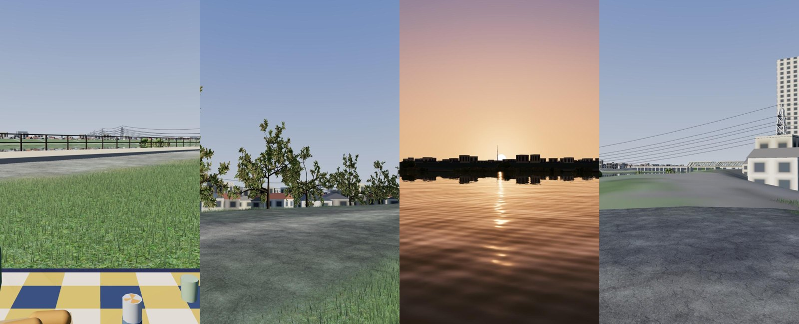

# 江戸川 写実版（Three.js）試作 — 記録

ドット絵版（[EDOGAWA_DESIGN.md](EDOGAWA_DESIGN.md)）と同じ場面データで、写実的な 3DCG の歩ける場面を作る試作の記録です。

- 詳細設計と計画：[江戸川 写実版（Three.js）試作 — 詳細設計と計画](https://claude.ai/code/artifact/e2a677c4-24db-44f1-9b86-2fa532f7cd03)
- ページ：`edogawa-real.html`（`?debug` で fps などを表示、`?quality=high|medium|low` で画質）
- コード：`real/`（写実の描画）。地形データ・太陽・季節・歩行は既存のもの（`scenes/edogawa/`、`engine/sun.js`・`season.js`・`player.js`・`collision.js`）を使う
- Three.js はこのページだけ `three@0.170.0`（ドット絵版は `0.160.0` のまま）
- 決めたこと（2026-10-20）：場所は市川南、季節は秋と初夏、素材は ambientCG・Poly Haven（CC0）と ez-tree（MIT）、2 週目の判断までは公開しない（`realistic-prototype` ブランチ）

## R0 基盤（2026-10-20）

| 項目 | 作り方 |
|---|---|
| 描画 | `WebGLRenderer`、MSAA、ACES のトーンマッピング（露出 0.55）、対数の深度（近 0.1 m〜遠 6 km） |
| 空 | `real/sky.js`。太陽の高さ（−12°〜60°）ごとの天頂・地平・太陽側の色を補間するグラデーションに、太陽のまわりの光と円盤。three の `Sky`（Preetham）は晴れた昼の天頂が白っぽく、青空にならなかったので使わない |
| 光 | 日光は実際の太陽の向き（`engine/sun.js`）で、強さ 8.2（夕方は暖色で弱く）。空を PMREM の環境光にして強さ 0.7（時刻を 0.04 時間以上変えたときだけ作り直す）。日光と空の光の比はおよそ 4 : 1 |
| 霞 | `FogExp2`（0.0004）。色は空の地平の色に合わせる |
| 影 | 日光の影 1 枚（高 2048 px・±70 m）。カメラについていき、影の格子に合わせて動かす |
| 地形 | `real/terrain.js`。近景 1 m・中景 4 m の高さ（`engine/terrain.js` の `loadHeightField`）。近景は地面の種類の色と空中写真の色の頂点色、中景は空中写真のテクスチャ |
| 水面 | 仮の平らな面（R2 で作り直す） |
| 画質 | `real/quality.js`：高・中・低（描く解像度・影）。⚙️ で切り替え |

確かめたこと：

- 4 つの視点（🧺・😴・🌇・🌉）に移れる。キーボードで歩くと、目の高さが地形に沿う
- M4 Pro の Mac（2048 × 1536 で描画）で 120 fps（表示の上限）。描画命令 4、三角形 41 万
- スマホの大きさ（375 × 812）でも開始画面・スティック・下部バーが表示され、操作できる
- 夕日（16:50）は、太陽のまわりの暖色と水面の光の筋が出る

残っていること（次の段階で直す）：

- 近くの地面がぼやけて平らに見える（R1 の素材と 25 cm の地形）
- 水面が空を強く映して白っぽい（R2）
- 舗装の色が明るすぎる（R1 で素材の色に）

## R1 地形と地面（2026-10-20）

| 項目 | 作り方 |
|---|---|
| 地形の細かさ | 近景の 1 m の高さを双三次（Catmull-Rom）で補間し、高 25 cm・中 50 cm・低 1 m の格子に（高で三角形 約 140 万）。歩くときの高さも同じ補間 |
| 地面の素材 | `real/ground.js`。ambientCG の 5 つ（芝・踏まれた芝・砂利・アスファルト・コンクリート）を色・凹凸・粗さのテクスチャ配列にまとめる（`assets/real/ground/`、計 3.8 MB）。地面の種類ごとに層を割り当てる（芝生・堤防の草・木の下 → 芝、踏まれた芝・ヨシ・川底 → 踏まれた芝、土 → 砂利、河川敷の道・堤防の上の道 → アスファルト、護岸 → コンクリート） |
| 色 | 色の平均は 1 m ごとの「地面の種類の色 7 割＋空中写真の色 3 割」（頂点色）。素材は平均で割って模様の明暗だけを足す。砂利・コンクリートは模様の明暗を弱める（contrast） |
| 境目 | 1 m の格子の 4 隅の層を、2 つの大きさのノイズでゆらがせた重みで混ぜる。格子の線が見えない |
| 繰り返し | 大きさ（3.7 倍）と向き（37°）の違う 2 枚の色を 6 : 4 で重ねる |
| 粗さ | 素材の粗さを層ごとの下限〜1 に読み替える。素材のままだと砂利・コンクリートが濡れたように空を映した |
| 凹凸 | 25 m から 90 m で弱めて消す（遠くのちらつき防止） |

確かめたこと：

- 芝生・砂利道・アスファルトの近くの見た目が写実的になった。境目は自然にぼける
- 高で 120 fps のまま（描画命令 4、三角形 143 万）。読み込みは 5 秒以内
- 素材の候補のうち Ground 048 は木のチップのような赤黒い地面で、河川敷の土に合わないので使わない（砂利を砂色にして代用）

残っていること：

- 30 m より先の芝の斜面が白っぽく平板に見える（R3 の草と、R5 の霞で直す）
- 水面（R2）

## R2 水（2026-10-20）

| 項目 | 作り方 |
|---|---|
| 反射 | three の `Reflector`（平面反射）。反射の解像度は画面の 高 1/2・中 0.35・低 1/4 |
| 波 | 手続きで作る。流れの向きの 6 つの波（波長 0.7〜7 m、高さ 4〜12 mm）＋ 3 つの大きさのノイズのさざ波。遠くは細かい波を弱めて、縞やちらつきを出さない |
| 反射の強さ | フレネル（水の F0 = 0.02）。足もとは水の中の色、遠くは空と対岸が映る |
| 水の色 | 濁った緑褐色（`#5c6040`）に、日光と空の明るさを掛ける。水深 0.9 m より浅い所は川底の色が透ける |
| 水深 | 地形から起動時に 50 cm ごとに計算してテクスチャに（近景＋西へ 90 m） |
| きらめき | 太陽の向きの鋭い光沢。夕日の光の筋になる |
| 岸 | 水深 12 cm より浅い所に、ゆれる泡の帯。水深 5 cm より浅い所は透明にして、地面との継ぎ目を見せない |

確かめたこと：

- 昼は濁った緑褐色の水に、不規則なさざ波と対岸の堤防が映る。夕日（16:50）は太陽の光の筋が水面に伸びる
- 高で 120 fps のまま
- はじめの波の高さ（最大 3 cm の長い波）では、規則的な縞に見えたので弱めた

## R3 草（2026-10-20）

| 項目 | 作り方 |
|---|---|
| 葉 | 1 本 7 頂点・5 三角形の帯。根もとから先へ細くなり、曲がる。タイル（2・4・8 m）ごとのインスタンスで、人のまわりのタイルだけを毎フレーム並べ直す（画面の外のタイルは描かない） |
| 段 | 高：足もと 12 m まで 500 本/m²、30 m まで 120 本/m²（幅 1.7 倍）、80 m まで 14 本/m²（幅 2.8 倍）。中：250・60・8 本（10・25・50 m）。低：120・25 本（8・20 m）。段の境目は本数を少しずつ入れ替える |
| 高さ・密度 | 地面の種類から（芝生 10 cm、木の下 9 cm、堤防の草 26 cm、踏まれた芝 5 cm で密度 35 %、ヨシ 1.3 m）。1 m ごとのマスクを線形補間するので、境目で少しずつ短く疎らになる |
| 色 | 地面の色の平均（`terrain.cellColor`）に合わせる。根もとは暗く、先は明るく黄みに。1 本ごとにむら |
| 根もと | 地形の高さ（50 cm ごと、半精度）をテクスチャで読む |
| 風 | 大きなうねり（突風）と細かい揺れ。先ほど大きく傾く |
| 光 | 葉の裏も表と同じ向きの法線（裏が暗くならない）。影は受けるが落とさない |

確かめたこと：

- 芝生の河川敷が、近くでは葉の立った草地、遠くでは地面の素材に自然につながる
- 高で 120 fps のまま（三角形 約 250 万、描画命令 7）。低でも描画の不具合なし（三角形 50 万）
- はじめの 1 段（120 本/m²）では葉がまばらで棒のように見えたので、3 段にした

### 中間の見比べ（1 週目の終わり）

（左から 🧺 シートの場所 12:00（座った目線）、同じ場所で立って上流、🌇 夕日 16:50、🌉 堤防の上 15:00）

- 良い：空・夕日・水面・近くの芝生と砂利道は、写実の方向に乗っている
- 弱い：🌉 の視点は近景の北の端にあり、見える斜面のほとんどが中景（4 m の格子と空中写真）で平板。木・橋・建物が無いので、場所の手がかりが少ない
- R4（木）・R5（遠景・構造物）で、場所らしさと奥行きを足す

## R4 木（2026-10-20）

| 項目 | 作り方 |
|---|---|
| 木の形 | `real/trees.js`。ez-tree 1.1.0（MIT、CDN から読む）の見本「Oak Medium」をもとに、樹種ごとに枝と葉を変えた形を 2 つずつ作る（ケヤキ風の落葉樹・幹が短く横に広がる桜・葉の細かい常緑樹）。ほかの見本（Ash・Aspen・Oak Small など）は葉がまばらな若木で、公園の木らしくなかった |
| 置き方 | 空中写真で見えた木 6 本と、堤防の町側の並木（ドット絵版と同じく 9 m おきの桜。樹種は確かめていない）の計 43 本。樹種は `treeKind`。高さは樹冠の半径から（桜 4.5 m＋半径、ほかは 5 m＋半径 × 1.5）、横幅は樹冠の直径に合わせる（縦の 0.7〜1.4 倍） |
| 描き方 | 形ごとに幹・枝と葉のインスタンス（描画命令 10 前後）。三角形は計 約 70 万。本数が少ないので、遠くの木を板にする仕組みは作っていない |
| 素材 | ez-tree の素材（Phong）は環境光を受けず暗いので、同じテクスチャで PBR に作り直す。葉は両面・アルファで切り抜き、日なたで透ける分だけ少し自分で光らせる（昼 0.12、夜 0） |
| 秋の桜 | 葉の明るさを残して赤茶・橙に塗り替える。樹冠の場所ごとに色づきをずらし、緑の残る葉もまぜる |
| 風・影 | 葉は木ごと・枝先ごとにずれて揺れる。葉の切り抜きのまま影を落とす（木漏れ日） |
| 当たり判定 | 近景の木の幹（半径 0.45 m） |
| 性能 | 水面の反射には草を描かない（草はレイヤー 1。反射はレイヤー 0 だけ） |

確かめたこと：

- 落葉樹は幹から枝が分かれ、葉の詰んだ樹冠になる。桜並木は緑に赤茶がまじる 10 月の見え方
- 高で、ふつうの視点は 120 fps。桜並木を斜めに見通す視点は 78 fps（三角形 310 万。切り抜きの葉と草の重なり）

## R5 遠景・構造物（2026-10-20）

| 項目 | 作り方 |
|---|---|
| 部品 | `real/structures.js`。ドット絵版の形の作り方（`engine/structures.js` の鉄橋・送電線・家並み、`engine/backdrop.js` の遠景の影絵、`realsite/edogawa-banks.js` の両岸の水際）をそのまま使い、素材だけ PBR にした（`pbr()` を toon の代わりに渡す） |
| 鉄橋 | JR 総武線（各駅停車・快速）・京成線・市川橋。塗装の色はドット絵版と同じ。鉄は少し金属に（metalness 0.35） |
| 町 | 家並み（インスタンス）と 8 階以上の建物（OSM の形を押し出す）。窓の模様は線形補間とミップマップでなめらかに |
| 中景の地面 | 町の所は空中写真の屋根の白さが強いので、写真の割合を 65 % から 45 % に下げた |
| 遠景 | スカイツリー・富士山などの影絵を 3.6 km の輪に立てる。色は空の地平・天頂の色と太陽の向きから（逆光で暗く） |
| 夕方の光 | 夕方は環境光を最大 55 % 弱める（逆光の対岸の建物が明るく浮いていた） |

確かめたこと：

- 🌉 の視点で、総武線のトラス橋・送電線と鉄塔・高い建物が見え、場所がわかるようになった
- 🌇 の夕日は、対岸の町並みの影絵の上で、スカイツリーのすぐ横に沈む（ドット絵版と同じ構図）
- 高で 120 fps（描画命令 33、三角形 約 200 万）

残っていること：

- 両岸の植え込み（ドット絵版の部品）が、なめらかな丸い塊でゲームのように見える（R7 で素材か形を替える）
- 近くの家の窓が大きな四角に見える（窓の模様が 2 × 2 の粗いもの）

## R6 ピクニック・季節（2026-10-20）

| 項目 | 作り方 |
|---|---|
| 持ち物 | すべてのピクニックの場面で共通の `engine/picnic-set.js` を、素材だけ PBR にして使う（シート・カップ・パン・トート・ランチバッグ・クッションと枕・文庫本・ランタン。秋はスープジャーと湯気、初夏は冷たいお茶） |
| 拠点 | `engine/basecamp.js`。⚙️ の「拠点」と B キーでシートを好きな場所へ移す（場所はブラウザに覚える。キーはドット絵版と別の `picnic-site:base:edogawa-real`）。🧺 はシートに戻って座る |
| シートの下の草 | シートの向きに合わせた四角の中の草を消す（`grass.hideRect`） |
| 座る・寝ころぶ | ドット絵版と同じ（🧺 で座る、😴 でその場に寝そべる、歩き出すと立つ） |
| 季節 | 秋（10 月 18 日）と初夏（6 月 1 日）の 2 つ。⚙️ で切り替えて読み直す。初夏は芝・堤防の草・ヨシを青々とした緑に、木の葉は `engine/season.js` の夏の色、太陽は 6 月 1 日の通り道。覚える場所はドット絵版の季節と別（`picnic-site:real-season`） |
| 音 | `engine/audio.js`。足音（地面の種類で）、川の水音（水際に近いほど）、川風（堤防の上で強く）、トビ、秋の虫（夕方から。初夏は鳴かない） |

確かめたこと：

- シートと持ち物がもとの場所に敷かれ、まわりの草はシートの縁で切れる。B キーで立っている前に敷き直し、「もとの場所」で戻る
- 初夏に切り替えると、草地が青々とし、太陽が高く（11 時に 74°）なる

途中で見つけて直したこと：

- 初夏の昼、木が真っ黒に見えた。葉が小さく影の解像度（約 7 cm）が粗いので、葉が 1 枚ずつ自分の影を受けていた。葉は影を受けないようにして、樹冠の内側・下側ほど暗くする陰で代えた。ez-tree の葉のテクスチャが暗いので、色も 1.7 倍に

## R7 画質・仕上げ（2026-10-20）

| 項目 | 内容 |
|---|---|
| 画質の段階 | `real/quality.js`。高・中・低で、描く解像度・影・地形の細かさ・地面の素材の大きさ・水の反射・木の葉の数・草の段を変える（下の表）。⚙️ の「画質」か `?quality=` で切り替え、ブラウザに覚える。指定が無ければ、タッチの端末は低、高解像度の画面は高、ほかは中 |
| 低の軽さ | 木の葉を 45 % に減らして 1 枚を大きく（木の三角形 69 万 → 40 万）、水面は空の色だけを映す（反射の描き直しなし） |
| 対岸の植え込み | ドット絵版の多面体の塊に、場所で決まるノイズで明暗のむらと凹凸を付けた（`foliageMassMaterial`）。まだ丸い塊に見える |
| 入口ページ | `index.html` に「江戸川のピクニック（写実版・試作）」を足した（ブランチの中だけ。公開はしていない） |
| 出典 | ⚙️ の下に ambientCG（CC0）と ez-tree（MIT）を足した。素材の一覧は `assets/real/ATTRIBUTION.md` |

| 画質 | 解像度の倍率 | 影 | 地形の格子 | 地面の素材 | 水の反射 | 木の葉 | 草（本/m²・外側の半径） |
|---|---|---|---|---|---|---|---|
| 高 | 2 | 2048 px・±70 m | 25 cm | 1024 px | 画面の 1/2 | 100 % | 500（12 m）・120（30 m）・14（80 m） |
| 中 | 1.5 | 1024 px・±60 m | 50 cm | 1024 px | 0.35 | 75 % | 250（10 m）・60（25 m）・8（50 m） |
| 低 | 1 | 1024 px・±45 m | 1 m | 512 px | 空の色だけ | 45 % | 120（8 m）・25（20 m） |

測った数（この Mac・アプリ内のブラウザ。fps は画面の上限 120 で頭打ち）：

| 画質・視点 | fps | 描画命令 | 三角形 |
|---|---|---|---|
| 高・🧺 シート（1090 × 1770） | 102〜120 | 73 | 236 万 |
| 高・桜並木を見通す | 68〜78 | 26 | 237 万 |
| 高・🌇 夕日 | 120 | 17 | 201 万 |
| 低・🧺 シート（スマホの大きさ 375 × 812） | 119 | 78 | 93 万 |
| 低・🌇 夕日（スマホの大きさ） | 120 | 18 | 90 万 |

- 実際の iPhone・M1〜M3 の Mac では測っていない（この Mac で画面の大きさを変えて確かめただけ）

### 2 週目の終わりの判断の材料

（左から 🧺 シートに座って 12:00、堤防の上の桜並木 14:00、🌇 夕日 16:50、🌉 堤防の上 15:00。高画質）

| 項目 | ブラウザ（Three.js）での出来 | UE5 に移ると良くなるか |
|---|---|---|
| 空・夕日・水面 | 写実に近い。夕日の光の筋、対岸と空の映り込み | 少し（雲・大気の厚み） |
| 近くの芝生・砂利道 | 写実に近い（草の葉 1 本ずつ、PBR の地面） | 少し |
| 木 | 遠目には自然。近くでは葉の板が見え、枝ぶりが単調 | 大きく（Nanite の植生・高品質の樹木素材） |
| 構造物・町 | 形は正しいが、箱に窓の模様の素朴な見た目 | 大きく（ただし素材・モデルを集める手間は同じだけかかる） |
| 遠くの斜面（中景） | 4 m の格子と空中写真で平板 | 中（地形の細かさはデータ次第） |
| 光の回り込み | 環境光だけ（木陰・軒下が明るすぎる・暗すぎる所がある） | 大きく（Lumen） |
| 届けやすさ | ブラウザでそのまま歩ける。スマホでも動く | 下がる（アプリの配布か、利用者ごとに費用のかかるサーバー配信） |

- 見立て：歩ける場所としてサイトで公開するなら、このまま Three.js で仕上げ、ほかの場所（なぎさ公園・妙典）にも広げるのがよい。映像や静止画の「作品」としての質を最優先するなら、木・町・光の回り込みが大きく良くなる UE5 を検討する
- 同じ場面データ（`scenes/edogawa/`）は、どちらでも使える

## なぎさ公園・妙典への展開（2026-10-20）

江戸川の写実版の作りを、なぎさ公園（`nagisa-real.html`）と妙典の岸（`myoden-real.html`）に広げた。

| 項目 | 内容 |
|---|---|
| 共通の組み立て | `real/app.js` の `startRealScene(site)`。描画・空・地形・水面・草・木・遠景と構造物・ピクニック・歩行・視点・季節・画質・音をまとめた。ページは HTML の部品と、場面ごとの設定（データの場所・視点のキー・樹種の割合・並木・橋の色・その場面だけの施設 `build`）を渡すだけ。江戸川の写実版もこれで書き直した |
| 構造物 | `real/structures.js` に場面ごとの設定を足した（橋の色、紅白の鉄塔、家並みの範囲、工場・倉庫の地区、建物ごとの素材、近景のまわりの建物と当たり判定、野球場の内野、遠景の影絵の追加） |
| 遠くの木 | 木が多い場面（なぎさ公園 588 本）のために、近い順に高 35・中 22・低 12 本までを立体で、ほかは同じ木を横から写した絵を十字の板に貼って描く（インポスター。`real/trees.js`）。立体と板は 4 m 動くたびに分け直す |
| 近景の格子 | なぎさ公園（361 × 371 m）・妙典（361 × 451 m）は近景が広いので、格子を画質の値の 2 倍に（高で 50 cm） |
| 水の流れ | `data.water.river`（上流から下流の線）の向きから |
| なぎさ公園の施設 | ドット絵版の部品（魔法の文学館・カフェのデッキ・ポニーの馬場と乗馬・ポニーランド・ヤギ・順番を待つ親子・胸壁と生け垣・電柱・藤棚とテーブル・遊具・ツツジ山・シンデレラ城と火山・水族園のドーム・大観覧車・東京ゲートブリッジの影絵）を PBR の素材で |
| 妙典の施設 | 水管橋（白いトラスと 3 つのアーチ）・東西線の車両基地・小舟・貸しボート屋と桟橋・妙典橋の街灯・水際のベンチ・堤防の上の縁石・クリーンセンターの煙突と工場・対岸の工場と倉庫 |

測った数（この Mac、高画質、1090 × 1770）：

| 場面・視点 | fps | 三角形 |
|---|---|---|
| なぎさ公園・🧺 シート（大きな木の下） | 58 | 約 370 万 |
| なぎさ公園・🌇 夕日 | 70 | 約 370 万 |
| なぎさ公園・🌊 川辺／🐴 ポニーランド | 116／105 | — |
| 妙典・🚲 堤防の上／🌉 水管橋／🌇 夕日 | 107〜117／111／108 | 約 295 万 |
| なぎさ公園・低（🧺） | 120 | 181 万（描画命令 97） |

- なぎさ公園の重さの大半は木（木を消すと 58 → 99 fps）。立体の木を 60 本から 35 本に、葉を 85 % にして 42 → 58 fps
- ドット絵版のなぎさ公園のページで、ポニーの馬場の柵の当たり判定が、定義されていない `gateA` を使っている（柵に近づくと止まる不具合のはず）。写実版では門の向きから計算した。ドット絵版はまだ直していない

残っていること：

- 人・ポニー・ヤギ・ツツジ・遊具などはドット絵版の箱の形のままで、写実の中では人形のように見える
- 画質「低」でもなぎさ公園は描画命令が 100 前後と多い（建物・施設が多い）。実際のスマホでは測っていない
- 妙典の対岸（田尻、`myoden-far.html`）の写実版はまだ
