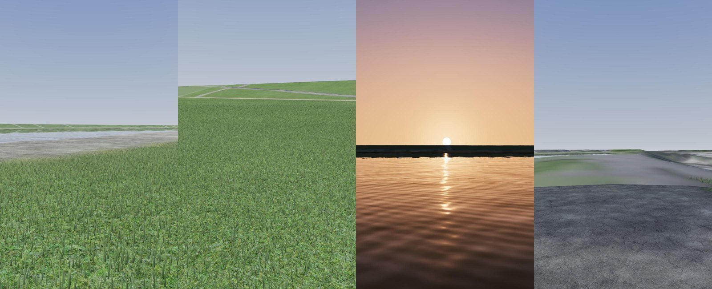

# 江戸川 写実版（Three.js）試作 — 記録

ドット絵版（[EDOGAWA_DESIGN.md](EDOGAWA_DESIGN.md)）と同じ場面データで、写実的な 3DCG の歩ける場面を作る試作の記録です。

- 詳細設計と計画：[江戸川 写実版（Three.js）試作 — 詳細設計と計画](https://claude.ai/code/artifact/e2a677c4-24db-44f1-9b86-2fa532f7cd03)
- ページ：`edogawa-real.html`（`?debug` で fps などを表示、`?quality=high|medium|low` で画質）
- コード：`real/`（写実の描画）。地形データ・太陽・季節・歩行は既存のもの（`scenes/edogawa/`、`engine/sun.js`・`season.js`・`player.js`・`collision.js`）を使う
- Three.js はこのページだけ `three@0.170.0`（ドット絵版は `0.160.0` のまま）
- 決めたこと（2026-10-20）：場所は市川南、季節は秋と初夏、素材は ambientCG・Poly Haven（CC0）と ez-tree（MIT）、2 週目の判断までは公開しない（`realistic-prototype` ブランチ）

## R0 基盤（2026-10-20）

| 項目 | 作り方 |
|---|---|
| 描画 | `WebGLRenderer`、MSAA、ACES のトーンマッピング（露出 0.55）、対数の深度（近 0.1 m〜遠 6 km） |
| 空 | `real/sky.js`。太陽の高さ（−12°〜60°）ごとの天頂・地平・太陽側の色を補間するグラデーションに、太陽のまわりの光と円盤。three の `Sky`（Preetham）は晴れた昼の天頂が白っぽく、青空にならなかったので使わない |
| 光 | 日光は実際の太陽の向き（`engine/sun.js`）で、強さ 8.2（夕方は暖色で弱く）。空を PMREM の環境光にして強さ 0.7（時刻を 0.04 時間以上変えたときだけ作り直す）。日光と空の光の比はおよそ 4 : 1 |
| 霞 | `FogExp2`（0.0004）。色は空の地平の色に合わせる |
| 影 | 日光の影 1 枚（高 2048 px・±70 m）。カメラについていき、影の格子に合わせて動かす |
| 地形 | `real/terrain.js`。近景 1 m・中景 4 m の高さ（`engine/terrain.js` の `loadHeightField`）。近景は地面の種類の色と空中写真の色の頂点色、中景は空中写真のテクスチャ |
| 水面 | 仮の平らな面（R2 で作り直す） |
| 画質 | `real/quality.js`：高・中・低（描く解像度・影）。⚙️ で切り替え |

確かめたこと：

- 4 つの視点（🧺・😴・🌇・🌉）に移れる。キーボードで歩くと、目の高さが地形に沿う
- M4 Pro の Mac（2048 × 1536 で描画）で 120 fps（表示の上限）。描画命令 4、三角形 41 万
- スマホの大きさ（375 × 812）でも開始画面・スティック・下部バーが表示され、操作できる
- 夕日（16:50）は、太陽のまわりの暖色と水面の光の筋が出る

残っていること（次の段階で直す）：

- 近くの地面がぼやけて平らに見える（R1 の素材と 25 cm の地形）
- 水面が空を強く映して白っぽい（R2）
- 舗装の色が明るすぎる（R1 で素材の色に）

## R1 地形と地面（2026-10-20）

| 項目 | 作り方 |
|---|---|
| 地形の細かさ | 近景の 1 m の高さを双三次（Catmull-Rom）で補間し、高 25 cm・中 50 cm・低 1 m の格子に（高で三角形 約 140 万）。歩くときの高さも同じ補間 |
| 地面の素材 | `real/ground.js`。ambientCG の 5 つ（芝・踏まれた芝・砂利・アスファルト・コンクリート）を色・凹凸・粗さのテクスチャ配列にまとめる（`assets/real/ground/`、計 3.8 MB）。地面の種類ごとに層を割り当てる（芝生・堤防の草・木の下 → 芝、踏まれた芝・ヨシ・川底 → 踏まれた芝、土 → 砂利、河川敷の道・堤防の上の道 → アスファルト、護岸 → コンクリート） |
| 色 | 色の平均は 1 m ごとの「地面の種類の色 7 割＋空中写真の色 3 割」（頂点色）。素材は平均で割って模様の明暗だけを足す。砂利・コンクリートは模様の明暗を弱める（contrast） |
| 境目 | 1 m の格子の 4 隅の層を、2 つの大きさのノイズでゆらがせた重みで混ぜる。格子の線が見えない |
| 繰り返し | 大きさ（3.7 倍）と向き（37°）の違う 2 枚の色を 6 : 4 で重ねる |
| 粗さ | 素材の粗さを層ごとの下限〜1 に読み替える。素材のままだと砂利・コンクリートが濡れたように空を映した |
| 凹凸 | 25 m から 90 m で弱めて消す（遠くのちらつき防止） |

確かめたこと：

- 芝生・砂利道・アスファルトの近くの見た目が写実的になった。境目は自然にぼける
- 高で 120 fps のまま（描画命令 4、三角形 143 万）。読み込みは 5 秒以内
- 素材の候補のうち Ground 048 は木のチップのような赤黒い地面で、河川敷の土に合わないので使わない（砂利を砂色にして代用）

残っていること：

- 30 m より先の芝の斜面が白っぽく平板に見える（R3 の草と、R5 の霞で直す）
- 水面（R2）

## R2 水（2026-10-20）

| 項目 | 作り方 |
|---|---|
| 反射 | three の `Reflector`（平面反射）。反射の解像度は画面の 高 1/2・中 0.35・低 1/4 |
| 波 | 手続きで作る。流れの向きの 6 つの波（波長 0.7〜7 m、高さ 4〜12 mm）＋ 3 つの大きさのノイズのさざ波。遠くは細かい波を弱めて、縞やちらつきを出さない |
| 反射の強さ | フレネル（水の F0 = 0.02）。足もとは水の中の色、遠くは空と対岸が映る |
| 水の色 | 濁った緑褐色（`#5c6040`）に、日光と空の明るさを掛ける。水深 0.9 m より浅い所は川底の色が透ける |
| 水深 | 地形から起動時に 50 cm ごとに計算してテクスチャに（近景＋西へ 90 m） |
| きらめき | 太陽の向きの鋭い光沢。夕日の光の筋になる |
| 岸 | 水深 12 cm より浅い所に、ゆれる泡の帯。水深 5 cm より浅い所は透明にして、地面との継ぎ目を見せない |

確かめたこと：

- 昼は濁った緑褐色の水に、不規則なさざ波と対岸の堤防が映る。夕日（16:50）は太陽の光の筋が水面に伸びる
- 高で 120 fps のまま
- はじめの波の高さ（最大 3 cm の長い波）では、規則的な縞に見えたので弱めた

## R3 草（2026-10-20）

| 項目 | 作り方 |
|---|---|
| 葉 | 1 本 7 頂点・5 三角形の帯。根もとから先へ細くなり、曲がる。タイル（2・4・8 m）ごとのインスタンスで、人のまわりのタイルだけを毎フレーム並べ直す（画面の外のタイルは描かない） |
| 段 | 高：足もと 12 m まで 500 本/m²、30 m まで 120 本/m²（幅 1.7 倍）、80 m まで 14 本/m²（幅 2.8 倍）。中：250・60・8 本（10・25・50 m）。低：120・25 本（8・20 m）。段の境目は本数を少しずつ入れ替える |
| 高さ・密度 | 地面の種類から（芝生 10 cm、木の下 9 cm、堤防の草 26 cm、踏まれた芝 5 cm で密度 35 %、ヨシ 1.3 m）。1 m ごとのマスクを線形補間するので、境目で少しずつ短く疎らになる |
| 色 | 地面の色の平均（`terrain.cellColor`）に合わせる。根もとは暗く、先は明るく黄みに。1 本ごとにむら |
| 根もと | 地形の高さ（50 cm ごと、半精度）をテクスチャで読む |
| 風 | 大きなうねり（突風）と細かい揺れ。先ほど大きく傾く |
| 光 | 葉の裏も表と同じ向きの法線（裏が暗くならない）。影は受けるが落とさない |

確かめたこと：

- 芝生の河川敷が、近くでは葉の立った草地、遠くでは地面の素材に自然につながる
- 高で 120 fps のまま（三角形 約 250 万、描画命令 7）。低でも描画の不具合なし（三角形 50 万）
- はじめの 1 段（120 本/m²）では葉がまばらで棒のように見えたので、3 段にした

### 中間の見比べ（1 週目の終わり）

（左から 🧺 シートの場所 12:00（座った目線）、同じ場所で立って上流、🌇 夕日 16:50、🌉 堤防の上 15:00）

- 良い：空・夕日・水面・近くの芝生と砂利道は、写実の方向に乗っている
- 弱い：🌉 の視点は近景の北の端にあり、見える斜面のほとんどが中景（4 m の格子と空中写真）で平板。木・橋・建物が無いので、場所の手がかりが少ない
- R4（木）・R5（遠景・構造物）で、場所らしさと奥行きを足す

## R4 木（2026-10-20）

| 項目 | 作り方 |
|---|---|
| 木の形 | `real/trees.js`。ez-tree 1.1.0（MIT、CDN から読む）の見本「Oak Medium」をもとに、樹種ごとに枝と葉を変えた形を 2 つずつ作る（ケヤキ風の落葉樹・幹が短く横に広がる桜・葉の細かい常緑樹）。ほかの見本（Ash・Aspen・Oak Small など）は葉がまばらな若木で、公園の木らしくなかった |
| 置き方 | 空中写真で見えた木 6 本と、堤防の町側の並木（ドット絵版と同じく 9 m おきの桜。樹種は確かめていない）の計 43 本。樹種は `treeKind`。高さは樹冠の半径から（桜 4.5 m＋半径、ほかは 5 m＋半径 × 1.5）、横幅は樹冠の直径に合わせる（縦の 0.7〜1.4 倍） |
| 描き方 | 形ごとに幹・枝と葉のインスタンス（描画命令 10 前後）。三角形は計 約 70 万。本数が少ないので、遠くの木を板にする仕組みは作っていない |
| 素材 | ez-tree の素材（Phong）は環境光を受けず暗いので、同じテクスチャで PBR に作り直す。葉は両面・アルファで切り抜き、日なたで透ける分だけ少し自分で光らせる（昼 0.12、夜 0） |
| 秋の桜 | 葉の明るさを残して赤茶・橙に塗り替える。樹冠の場所ごとに色づきをずらし、緑の残る葉もまぜる |
| 風・影 | 葉は木ごと・枝先ごとにずれて揺れる。葉の切り抜きのまま影を落とす（木漏れ日） |
| 当たり判定 | 近景の木の幹（半径 0.45 m） |
| 性能 | 水面の反射には草を描かない（草はレイヤー 1。反射はレイヤー 0 だけ） |

確かめたこと：

- 落葉樹は幹から枝が分かれ、葉の詰んだ樹冠になる。桜並木は緑に赤茶がまじる 10 月の見え方
- 高で、ふつうの視点は 120 fps。桜並木を斜めに見通す視点は 78 fps（三角形 310 万。切り抜きの葉と草の重なり）
