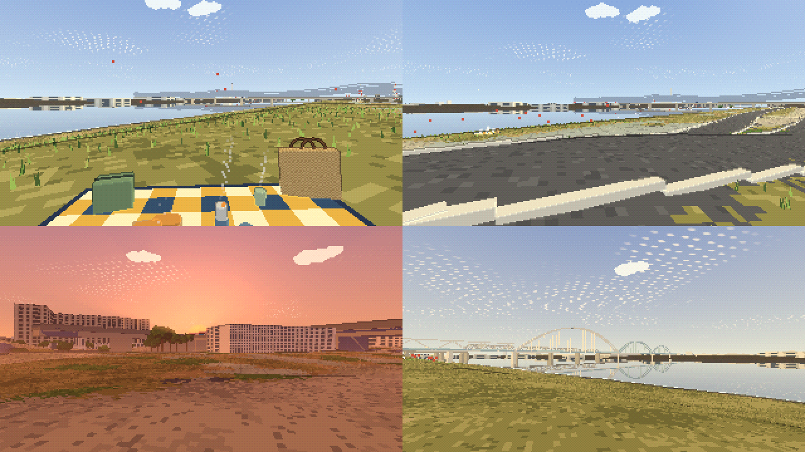
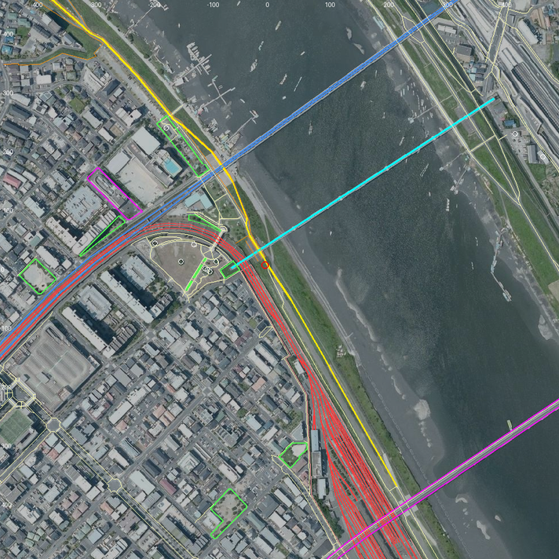

# 江戸川 妙典の岸（市川市 妙典）— 地形分析・設計・確認の記録

市川南の河川敷（[EDOGAWA_DESIGN.md](EDOGAWA_DESIGN.md)）の「川の逆側」として、江戸川の妙典の岸を、なぎさ公園（[NAGISA_DESIGN.md](NAGISA_DESIGN.md)）と同じ作り方で再現した場面です。

- 作成日：2026-10-19
- ページ：`myoden.html`（入口ページからも開けます）
- データ：`scenes/myoden/`（`python3 tools/geo/fetch_data.py --site myoden` → `python3 tools/geo/build_myoden.py`）

（左上から ランチ・🚲 堤防の上（360° 写真の視点）・夕日・🌉 アーチの水管橋。320×180 の描画を 2 倍に拡大）

---

## 1. 場所の決め方

アプリ内ブラウザで開いていた Google マップの 360° 写真（2025 年 6 月、北緯 35.694519・東経 139.931955、向き 104°、見下ろし 2.6°）の位置を、場面の原点にしました。妙典公園の東の、堤防の上の自転車・歩行者道です。🚲 の視点はこの写真と同じ場所・向きです。

- 川：行徳可動堰より下流の江戸川（もとの江戸川放水路）。川は北西から南東へ流れる（上流の方位 325°）。妙典は南西の岸
- 座標：-z が北、+x が東、y = 0 が TP 7.0 m、1 単位 = 1 m
- 近景 1 m（361 × 451 m：堤防・妙典公園・水際）、中景 8 m（6 km × 5.6 km：河口の湾岸道路・京葉線の橋まで）

## 1.1 周囲の詳細分析（2026-10-19）

原点から 600 m 以内の OSM の要素をすべて（約 7,150）調べ、空中写真に重ね、Google マップの 360° 写真を 2 か所（原点と、下流 190 m の川側の斜面）でまわりじゅう見て、場所ごとに整理しました。

（国土地理院 シームレス空中写真に OSM を重ねたもの。黄：堤防の上の道、赤：東西線の車両基地の線路、青：東西線の本線、水色：水管橋、桃：妙典給水場と妙典橋、緑：公園、白い丸：トイレ・木・貸しボート。数字は場面の座標（m）、赤い丸が原点）

| 場所 | 調べてわかったこと | 根拠 | 場面 |
|---|---|---|---|
| 堤防の上 | 濃い灰色のアスファルトの自転車・歩行者道（幅 約 4 m）。両側に白いコンクリートの縁石。原点は川側の低い道からの坂道が上がってくる分かれ道で、舗装が広い。下流側の道は 2023 年 3 月開通 | OSM、360° 写真 | 道・縁石・坂道。高さは 6.3 節 |
| 川側の斜面 | 堤防の上から芝の斜面で下がる。原点の北は水際の平らな芝にベンチ。下流 190 m では、斜面の下から水際まで 20 m ほどの芝で、水の中に杭が 2 本 | 360° 写真 2 か所 | 斜面・ベンチ 3 つ（杭は作っていない） |
| 水際 | 芝が水際まで来て、満ち潮では水際のコンクリートのブロックが暗い帯に見える | 写真 2 枚 | 暗い灰色の護岸の帯 |
| 川 | 堤防から 100〜120 m 先が水。干潮では干潟が出る。川の上・両岸の桟橋に小舟がたくさんつないである（とくに東西線の鉄橋より上流） | 空中写真、写真 | 水面 TP 1.0 m。小舟 93 そう（空中写真の白い塊から） |
| 町側の斜面の下 | 柵と、東京メトロ東西線の車両基地（妙典）。原点のすぐ南から下流へ、線路が扇形に約 30 本並ぶ。架線柱。木は無い | OSM（landuse=railway、service=yard の線路 26 本）、360° 写真 | 砂利と線路・架線柱・黒い網の柵・止めてある電車（6 両 × 4 本） |
| 北西 | 妙典公園（丸い広場）、妙典スーパー堤防自由広場、妙典給水場、東西線の本線の高架がカーブする。水管橋のトラスは堤防の陸側へ続き、車両基地の上を渡る | OSM、360° 写真 | 公園の木と道、水管橋の陸側のトラス |
| 上流の川 | 水管橋（トラス＋3 つのアーチ）、その奥に東西線の長いトラス | 写真、OSM | 6.1 節 |
| 対岸・上流の岸 | 低い堤防と自転車道、畑・草地・林、低い倉庫・工場、紅白の高い鉄塔、白い煙突と工場、貸しボート屋（林遊船・高常遊船、上流の妙典側にたかはし遊船など 5 軒）の桟橋 | OSM、写真 | 低い倉庫、鉄塔、煙突、貸しボート屋の小屋と 30 m の桟橋（畑・林は作っていない） |
| 下流 | 妙典橋（低く長い桁橋、白い円柱の橋脚、街灯）。橋のたもとにヨシ。その先に湾岸道路・京葉線の橋 | 写真、OSM | 桁橋と街灯（両側に 30 m おき、高さ 8 m は推定。ヨシは作っていない） |
| 家 | 堤防の上から見えるのは、町側の奥（車両基地の向こう）のマンションと家だけ。対岸・下流の川沿いには家はほとんど無い | 360° 写真 | 家は車両基地の向こうだけ |

## 2. 地形（標高データ・空中写真から）

| 項目 | 値 |
|---|---|
| 堤防の上 | TP 8.4 m（自転車・歩行者道。OSM の線を幅 4 m の舗装に）。6.3 節のとおり、標高データの古い区間を上げた |
| 川側 | 堤防の上から 6 m で TP 約 6 m の段、そこから芝の斜面で下り、40〜50 m 先の水際の道（TP 約 2.5 m）、その先は干潟と水（原点の断面で 117 m 先に標高データの水） |
| 町側 | 16 m ほどで TP 約 3.5 m（東西線の車両基地・道路）。北西は妙典公園 |
| 水面 | TP 1.0 m。潮の入る区間（干満 ±1 m）で、360° 写真では水が芝の縁まで来ていたので、満ち潮に近い高さにした |
| 木 | 空中写真から 170 本（妙典公園に多い）。堤防の川側の斜面の木は除いた（堤防には木を植えないので、写真のまだらを木と読んだもの） |
| 建物 | 近景のまわり 128 棟（OSM。屋根は写真の色）、高さ 25 m 以上 46 棟 |

## 3. 周りのもの

| 物 | 位置 | 作り方・根拠 |
|---|---|---|
| 東京メトロ東西線の鉄橋 | 北 約 200 m で川を渡る | 薄い灰色の長いトラス橋（OSM）。電車が渡る。写真では水管橋のアーチの奥に見える |
| 妙典給水場の水管橋 | 原点の 55 m 西から北東へ川を渡る（全長 531 m） | OSM の線（man_made=pipeline、overhead）。形は実際の写真から：妙典の岸の側が白いトラス（0〜130 m）、川の上に大・中・小の 3 つのアーチ（130〜270・270〜370・370〜450 m。1 つめは白、2・3 つめは淡い水色）、床の両側に太い白い水道管、白い円柱の橋脚。区切り・アーチの高さ（スパンの 0.19 倍）・床 TP 10.5 m は写真の見え方からの推定 |
| 妙典橋（船橋行徳線） | 下流 0.5 km | 桁橋（OSM）。船を通すので床を TP 12 m とした（推定）。車が走る |
| 河口の橋 | 下流 1.5〜2 km | 東京湾岸道路・首都高湾岸線・JR 京葉線・東関東道・外環（OSM） |
| 送電線 | 0.75〜1.5 km | 鉄塔 19 基、66 kV の 7 本（OSM）。写真に合わせて紅白に塗り分け、高さ 50 m |
| 市川市クリーンセンター（田尻）の煙突と工場 | 対岸 1.1 km、方位 124° | 写真では白い煙突と白い四角い工場。位置は送電線「市川クリーンセンター線」の終わり。煙突 100 m・工場 70×45×26 m は推定 |
| 対岸の町 | 原木・高谷・二俣 | 写真では低く平らな町並み。川の向こう側は、家並みを置かず、低い白い倉庫（高さ 5〜9 m）をまばらに置く |
| 遠景 | — | スカイツリー（279°・11 km）、東京タワー、富士山、都心のビル群の影絵 |

## 4. 視点（1〜5 キー）

| ボタン | 時刻 | 位置と向き |
|---|---|---|
| 🍲 ランチ | 12:00 | 堤防の川側の段の芝（x 18, z −6）にシート。方位 115°（下流の妙典橋・河口の方）。座った目で 459 m 見通せる |
| 😴 昼寝 | 13:30 | シートに寝ころんで空を見上げる |
| 🚲 堤防の上 | 10:30 | 360° 写真と同じ場所・向き（方位 104°、見下ろし 2.6°） |
| 🌇 夕日 | 16:51 | 堤防の上（x −44, z −44）から方位 258°。日は妙典の町の向こうに沈む |
| 🌉 アーチの水管橋 | 15:36 | 堤防の川側の斜面（x 80, z 100）から上流（方位 16°）。写真と同じく、左に水管橋のトラス、中ほどに大きなアーチ、右に 2 つのアーチ、奥に東西線の鉄橋 |

シート（拠点）は ⚙️ の「拠点」（B キー）で好きな場所へ移せます（[SPEC.md 9 章](SPEC.md)）。

## 5. 作ったもの

| 部品 | 内容 |
|---|---|
| `tools/geo/geo_common.py` | 場所 `myoden`（原点・範囲・水面の高さ） |
| `tools/geo/build_myoden.py` | なぎさ公園の部品（標高そのままの近景、写真から木、見通し）を使い、この場所の橋・水管橋・送電線・煙突・工場地区・視点を作る |
| `tools/geo/build_nagisa.py` | ほかの場所の作り方から部品を使えるように、場所の確認を `main()` の中へ |
| `engine/structures.js` の `createHouses` | `shape`（建物の大きさの幅・平屋根）を指定できるように。倉庫・工場に使う |
| `myoden.html` | なぎさ公園のページから、施設を除き、水管橋・倉庫・煙突・この場所の視点と場所の名前を足した |

## 6. 確認したこと

| 確認 | 結果 |
|---|---|
| ループの継ぎ目 | 5 視点とも、t と t + 6 秒の描画が全画素一致（見直しのあとも）。半周期ずらすと 32〜1,742 画素が違う（動いている） |
| 速さ | 1 コマ 1.3〜2.6 ms（周囲の詳細分析のあと：車両基地・小舟・遊船・街灯を足しても） |
| エラー | なし |

## 6.1 実際の写真を参考にした見直し（2026-10-19）

妙典の堤防から撮った 2 枚の写真（上流の橋、下流の妙典橋と対岸）をもとに直しました。

| 写真で見たこと | 直したこと |
|---|---|
| 3 つのアーチの橋（手前）と、奥の低いトラスに電車 | 位置から、アーチは妙典給水場の水管橋（床に水道管 2 本）、奥のトラスが東西線。水管橋をトラス＋3 つのアーチで作り直した（前は OSM の取り込みが漏れていて、水管橋が場面に無かった） |
| 対岸は低く平らで、ごちゃついていない | 川の向こう側の家並みをやめ、低い白い倉庫をまばらに。干潟の色を泥と枯れ草の色に |
| 紅白の高い鉄塔がたくさん | 鉄塔を紅白に塗り分け、高さ 50 m に |
| 白い煙突と白い工場 | 紅白の煙突をやめ、白い煙突と白い四角い工場に |
| 水際に暗い灰色のブロックの帯、芝は刈られて枯れ色 | 水面の線に沿った護岸の帯を暗い灰色に。芝の色を枯れ色寄りに |

## 6.2 360° 写真を見渡した見直し（2026-10-19）

実際の写真は 360° 写真と同じあたりから撮ったものなので、360° 写真をまわりじゅう見渡して直しました。

| 方位 | 360° 写真で見たこと | 直したこと |
|---|---|---|
| 18°（上流） | 水管橋の白いトラスがすぐ上を通り、その先にアーチ。斜面の下の水際の平らな芝にベンチ | トラスを高さ 6.5 m に。水際の芝にベンチ 3 つ |
| 112°（下流） | 濃い灰色のアスファルトの道の両側に白いコンクリートの縁石。右は芝と川だけで、家は見えない | 道を濃い灰色に、両側に縁石（OSM の自転車・歩行者道の外側の縁だけ）。堤防の町側 250 m には家を置かない |
| 194°（町側） | 芝の斜面の下は柵と東西線の車両基地の線路。木は無い | 堤防の町側のすぐ下（40 m）の木を除く |
| 285°（町側） | 水管橋のトラスが堤防の陸側へ続き、車両基地の上を渡る。下に淡い水色の水道管 | トラスを陸側へ 80 m のばし、水道管を淡い水色に |

## 6.3 堤防の高さの見直し（2026-10-19）

360° 写真では道が高い堤防の上にあるのに、場面では道のまわりが平らに見えていたので、地形を調べ直しました。

- 国土地理院の 1 m の標高データ（DEM1A）はこの場所に無く、使えるのは 5 m（DEM5A）だけ。
- 堤防の上の道（OSM の自転車・歩行者道）に沿って標高データを読むと、上流・下流とも **TP 8.3〜8.5 m** なのに、原点のまわりの約 380 m（上流 150 m〜下流 230 m）だけ **TP 6.0 m** に下がっていた。
- この区間の下流側の道は OSM で **2023 年 3 月 31 日の開通**（way 1126425114・1126425115）。水管橋・東西線の鉄橋もこの区間にあり、標高データの測量のあとに堤防が整備されたと考えられる。360° 写真（2025 年）でも、道の両側は斜面で下がっている。

| 直したこと | 内容 |
|---|---|
| 堤防の上 | 堤防の上の道（OSM way 210577374・1126425114・1126425115）に沿って、上面（幅 7 m）を TP 8.4 m（前後の区間と同じ）、両側を 1:2 の斜面に。低い所だけ上げ、ほかは標高データのまま |
| 坂道 | 川側の低い道から上がる坂道（way 995263365）は、下の端の高さから堤防の上まで一様に上がる |
| 結果 | 原点の断面：堤防の上 TP 8.4 m（前は道の所で 6.8〜7.4 m の山なり）、川側は TP 6 m の段まで、町側は TP 3.5 m の車両基地まで、どちらも斜面で下がる |

## 7. わかっていないこと・割り切ったこと

- 写真の **ピンクの夕焼け雲** は、空の作りが同じなのでありません。
- 写真には煙突が何本か写っていますが、OSM に煙突の情報がなく、場所がわかったのはクリーンセンターの 1 本だけです（高さも推定）。ほかの煙突は作っていません。
- 写真の水際にあった **赤白の柱**（量水標か標識）と、堤防の上の道の **白い線** は作っていません。
- 妙典橋・水管橋の高さは推定です。写真の妙典橋の **街灯** は作っていません。妙典橋は 🚲 の視点では目の高さとほぼ同じで、目立ちません。
- 堤防の上の高さ TP 8.4 m は、前後の区間の標高データからの推定です（整備後の測量値は確かめていません）。
- 水面は満ち潮に近い TP 1.0 m の一定の高さです（潮の満ち引きは動かしていません）。
- 対岸は OSM の工場地区だけを倉庫にしています。工場地区の書き込みのない所は家並みのままです。
- 車両基地の架線（電線）・ポイント・建物は作っていません。止めてある電車の位置は決め打ちです。
- 走る電車は東西線・京葉線の本線だけをたどります（車両基地の側線には入りません）。前は側線の高架の端から先へまっすぐ延ばした所で宙に浮いていました（[EDOGAWA_DESIGN.md 17 章](EDOGAWA_DESIGN.md)）。
- 小舟の位置は空中写真の時点のもので、今の並びとは違います。対岸の桟橋・貸しボート屋の建物は作っていません。
- 町側の 250 m より先の家並みと、OSM の高い建物（マンション）は残しています（360° 写真でも町側の奥に見える）。
- 写真の **釣り人・ボート** は作っていません。

## 8. 出典

- 国土地理院 基盤地図情報 数値標高モデル（DEM5A）・シームレス空中写真を加工して作成
- 地図データ © OpenStreetMap contributors（水管橋 way 454774418、東西線・妙典橋・送電線ほか）
- Google マップの 360° 写真（2025 年 6 月）：場所と向き、見た様子を参考にした（画像は使っていない）
- 実際の写真 2 枚（妙典の堤防から上流・下流）：橋の形、対岸の様子、色を参考にした（画像は使っていない）
- 市川市クリーンセンターの所在地：千葉県 環境影響評価「市川市次期クリーンセンター」 https://www.pref.chiba.lg.jp/kansei/eikyouhyouka/jigyou/128_ichikawa/ichikawakurinnsennta.html
