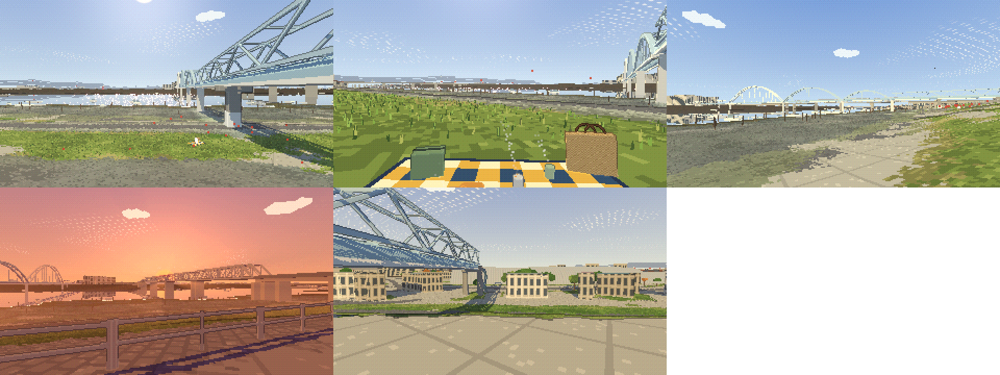
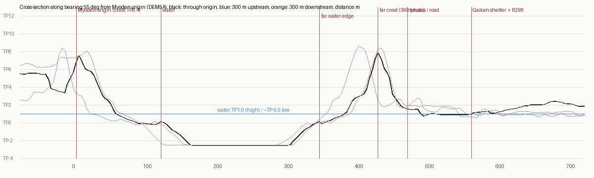
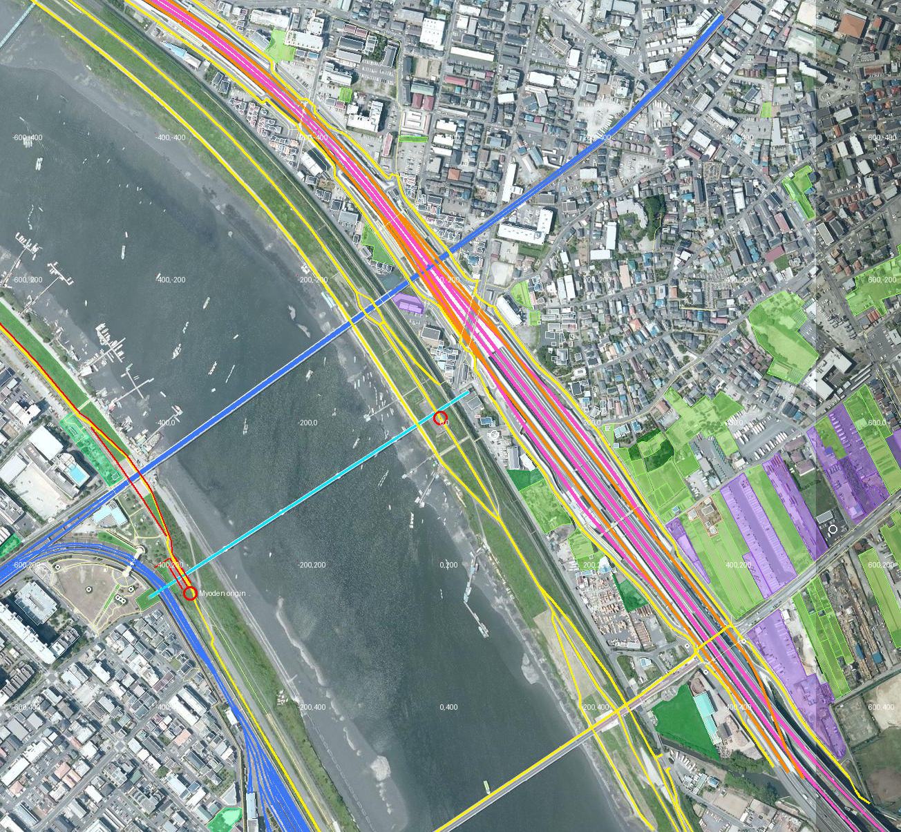

# 妙典の対岸（市川市 田尻・高谷）— 調査と分析

妙典の岸（[MYODEN_DESIGN.md](MYODEN_DESIGN.md)）を、川の向こう岸から見る場面です。妙典の場面と同じ作り方・同じ細かさで作れるよう、標高・空中写真・OSM・360° 写真・紹介記事を突き合わせ（1〜5 章）、その結果から場面を作りました（7 章）。

- 調査日・作成日：2026-10-20
- 調べた範囲：対岸の堤防の上（下の 360° 写真の地点）から半径 650 m
- ページ：`myoden-far.html`（入口ページからも開けます）
- データ：`scenes/myoden-far/`（`python3 tools/geo/fetch_data.py --site myoden-far` → `python3 tools/geo/build_myoden_far.py`）

（左上から 🏞️ 堤防の上（360° 写真の視点）・🍲 ランチ・🌉 水管橋、下は 🌇 夕日・🏠 振り返る。干潮。320×180 の描画を 2 倍に拡大）

---

## 1. 視点の場所

| 項目 | 値 |
|---|---|
| 位置 | 北緯 35.696700・東経 139.935823（市川市 田尻／高谷の境、江戸川の左岸の堤防の上） |
| 根拠 | Google マップの 360° 写真（投稿者の写真、2020 年 10 月、「田尻」）。堤防の上で妙典を向くと正面に水管橋のアーチ、右に東西線の鉄橋が見える |
| 妙典の場面の原点から | 425 m、方位 55°（妙典の原点から見て真向かい）。妙典の場面の座標で (351, −246) |
| 妙典を向く方位 | 235°（南西）。午後は逆光になる（夕日は妙典の側、西南西に沈む） |

近くの 360° 写真：上流 300 m（北緯 35.698912・東経 139.933985、川の距離標「2.25」が立つ）、下流 300 m（北緯 35.694337・東経 139.937511、「高谷」）、陸側のふもとの道（Google の車、2026 年 8 月・2025 年 8 月）。

## 2. 地形（標高 DEM5A）

（妙典の原点から方位 55° の断面。黒：原点を通る線、青：300 m 上流、橙：300 m 下流。縦は TP m、横は妙典の原点からの距離 m）

| 区間（妙典の原点からの距離） | 高さ | わかったこと |
|---|---|---|
| 0〜120 m | TP 8.4 → 1 | 妙典の堤防と川側の芝（今の場面） |
| 120〜345 m | 水（標高データでは TP −2.5 の水面の穴） | 川幅 約 220 m。干潮では両岸に干潟が出る |
| 345〜410 m | TP 0 → 3 のゆるい坂 | **対岸の河川敷は低く狭い**（60〜70 m）。水際は干潟とヨシ、その上に草地と管理用の舗装の道 |
| 410〜428 m | TP 3 → 7.5〜8.5 | 川側の斜面（18 m で 5 m 上がる。1:3.5 ほど） |
| 堤防の上 | TP 7.5〜8.5 | 幅 6〜8 m。妙典の堤防（TP 8.4）とほぼ同じ高さ。標高データは古い所がある（妙典では工事のあとの高さに直した。6.3 節） |
| 428〜460 m | TP 8 → 2 | 陸側の斜面は急（25 m で 6 m） |
| 460 m〜 | TP 1〜2 の平地 | ふもとの道、家、外環道と国道 298 号（560 m あたりから）、その先は高谷の町 |

上流・下流 300 m でも形は同じ（堤防の位置が川に沿って少しずつずれるだけ）。

## 3. 場所ごとの分析

（国土地理院 シームレス空中写真に OSM を重ねたもの。黄：自転車・歩行者道、桃：外環道、橙：国道 298 号、青：東西線、水色：水管橋、紫：工業地、黄緑：畑、緑：公園・草地、白い丸：貸しボート・駐車場など。赤い丸は対岸の視点と妙典の原点。数字は対岸の視点からの m（x 東、z 南））

| 場所 | 調べてわかったこと | 根拠 |
|---|---|---|
| 堤防の上 | **コンクリートの舗装**（ひびと継ぎ目がはっきり見える、幅 5 m ほど）。川側の縁に鋼の管の低いガードレール。下流へまっすぐ、上流は水管橋の下をくぐる | 360° 写真 3 か所 |
| 川側の斜面の上 | 斜面の上の端はコンクリートの板で覆われ、その下が芝の斜面 | 360° 写真（方位 200°） |
| 河川敷 | 斜面の下に灰色の舗装の道（管理用）、その川側に草とヨシの細い帯。下流側は芝の広い所もある | 360° 写真、空中写真 |
| 水際・干潟 | 干潮で泥の干潟が広く出る。木の杭がたくさん立ち、古い木の桟橋（船宿の）と小舟がつないである。カキ殻（河川事務所の利用ルールに「採ったカキの殻を持ち帰る」） | 360° 写真（2020 年 10 月、干潮）、江戸川河川事務所 |
| 船宿 | 林遊船・高谷側の高常遊船（OSM の貸しボート）。対岸の妙典側にたかはし遊船など。ハゼ釣りの船宿で、桟橋と貸しボート。夏〜秋が季節 | OSM、BE-PAL・市川市の資料 |
| 水管橋（妙典給水場から） | **こちら側の端は堤防の上をまたぐ**。太い白い管 2 本の上に淡い水色のワーレントラス、灰色の四角い橋脚（下半分が白い）。堤防を越えた陸側でコンクリートの塔（階段つき）に下りる。川の上は淡い水色のアーチ | 360° 写真（方位 270・325・55°）、ストリートビュー（陸側） |
| 東京メトロ東西線 | 上流（右手）に長い灰青色のトラス橋と橋脚 | 360° 写真（方位 270°） |
| 堤防の陸側のすぐ下 | ふもとの道（アスファルト、片側に白い手すり、電柱と電線が並ぶ）。2〜3 階の古いアパート・家・駐車場が堤防に接して並ぶ。斜面のふもとに緑の金網の柵と低木 | ストリートビュー（2026 年 8 月） |
| 外環道・国道 298 号 | 堤防から 130 m ほど陸側を、川に沿って走る。外環道は半地下で、ここでは **銀色の波板のかまぼこ形の遮音シェルター**（高さ 10 m 以上に見える）に覆われ、両側に国道 298 号と植え込み。堤防の上から家並みの向こうに白く長い屋根として見える。市川南 IC・高谷 JCT が近い | ストリートビュー（2025 年 8 月）、360° 写真（方位 55°）、OSM、国土交通省の事業資料（半地下が基本） |
| 下流の陸側 | 田尻の畑（OSM の畑 49 区画）と倉庫・工場（工業地 17）。駐車場と 3 階建ての集合住宅。遠くに送電線の鉄塔 | OSM、空中写真、360° 写真（方位 145°） |
| 正面（妙典側） | 低い堤防の線の上に、妙典駅まわりの中層マンションが少し。木は少ない。妙典の堤防の上の道（TP 8.4）は対岸からはほぼ水平の線 | 360° 写真（方位 235°） |
| 下流の川 | 妙典橋（低く長い桁橋）、その奥に送電線の鉄塔 2 基 | 360° 写真（方位 200°） |

## 4. 妙典の場面との違い（作るときの要点）

1. **見る向きが逆**：妙典の場面は南西の岸から北東を見た。対岸は北東の岸から南西を見る。昼は太陽が正面（逆光）、夕日は妙典の側に沈むので **夕日の場面は対岸のほうが映える**。
2. **潮**：妙典の場面は満ち潮（水面 TP 1.0）。対岸の 360° 写真は干潮で、干潟・杭・桟橋・カキ殻が見どころ。干潮（TP −0.5 ほど）で干潟を出すか、潮の高さを選べるようにすると、この岸らしさが出る。
3. **堤防の上の舗装**：妙典は濃い灰色のアスファルト、対岸は明るい灰色のコンクリート（継ぎ目とひび）。
4. **陸側がすぐ町**：妙典は車両基地が広がって家が遠かったが、対岸は堤防のすぐ下に家とアパート、その奥に外環道のシェルター。振り返ると町が近い。
5. **水管橋が頭の上を通る**：視点の 20〜30 m 上流で、水管橋が堤防をまたぐ。妙典の場面の水管橋（`createArchPipeBridge`）の陸側の端を作り直す必要がある（こちら側はトラスと管、四角い橋脚、陸側の塔）。
6. **再利用できるもの**：妙典の場面の地形の作り方（`build_myoden.py`）、水管橋・東西線・妙典橋・電車の線路（`railways`）、貸しボート屋の小屋と桟橋、小舟、季節。対岸から見える「妙典の岸」は、今の妙典の場面の近景がそのまま遠景になる。

## 5. わからないこと

- 堤防の上の今の舗装：360° 写真は 2020 年。Google の車の写真は陸側の道だけで、堤防の上は無い。
- 遮音シェルターの高さ・長さ（資料では見つからない。写真の見え方から 10〜15 m と推定）。
- 水管橋のこちら側の正確な形（橋脚の数・塔の位置）：写真からは、堤防の上に 1 基、陸側に 1 基。
- 干潟の広さは潮で変わる（空中写真は撮った時の潮）。
- 船宿の桟橋・小屋の今の様子（記事は妙典側のたかはし遊船が中心）。

## 6. 作り方の案（調べた時点）

| 項目 | 案 |
|---|---|
| ページ | `myoden-far.html`（妙典の場面と同じ部品）。場所の設定 `myoden-far`：原点は 1 章の位置、TP 7.5、-z が北 |
| 近景（1 m） | 堤防の上から川側 90 m・陸側 60 m、川に沿って 450 m。堤防の高さは妙典と同じように工事のあとの値を当てる |
| 中景 | 妙典の場面と同じ範囲（妙典の岸が対岸の景色になる） |
| 地面 | コンクリートの堤防の上、芝の斜面、管理用の道、ヨシの帯、干潟（泥と杭とカキ殻）、ふもとの道 |
| 物 | 水管橋のこちら側の端（堤防をまたぐトラスと陸側の塔）、木の桟橋と杭、船宿の小屋、小舟、家とアパート、外環道のシェルター（かまぼこ形）と国道 298 号、電柱 |
| 視点 | 🍲 堤防の川側の斜面の上（ランチ）、🌇 夕日（妙典の側に沈む）、🌉 水管橋の下、🎣 干潟と桟橋、🏠 振り返って町とシェルター |
| 潮 | 干潮・満ち潮を選べるように（干潟の見え方が大きく変わる） |

## 7. 作ったもの（2026-10-20）

| 項目 | 内容 |
|---|---|
| 場所の設定 | `myoden-far`（`tools/geo/geo_common.py`）：原点は 1 章の 360° 写真の位置、y = 0 が TP 7.5 m、-z が北。標高タイルは妙典と同じ範囲。空中写真は両岸 |
| 近景（1 m） | x −200〜180、z −240〜220（堤防・河川敷・干潟・ふもとの町と外環道の出口） |
| 堤防の上 | OSM の道（way 903500800）のうち標高データで TP 7 m 以上の区間を TP 8.4 m に（原点のまわりは 7.8〜8.0 に下がっていた）。東西線の鉄橋の下で道が TP 5.8 m に下がる所はそのまま。幅 6 m の明るい灰色のコンクリート、川側の縁に幅 3 m のコンクリートの板と鋼の管のガードレール |
| 河川敷・水際 | 河川敷の道（OSM の歩道・小道で TP 5 m より低い所）は灰色の舗装。満ち潮の水際から TP 1.9 m までは草とヨシ。満ち潮の水面より低い陸は泥の干潟 |
| 潮 | ⚙️ の「潮」で干潮（TP −0.3 m、既定）か満ち潮（TP 1.0 m）。干潮では干潟と杭が出て、干潟の上の小舟は泥に乗る。桟橋は満ち潮の 0.8 m 上で、干潮では脚が見える |
| 杭 | 林遊船・高常遊船の前に、川へ向かう 5 列。ほかは水際に散らす（194 本。並びは推定） |
| 水管橋 | 対岸の 360° 写真に合わせて、アーチは水際（線の始まりから 410 m）で終わり、そこから陸側の塔（531 m）まで淡い水色のワーレントラス。堤防の上と河川敷に四角い橋脚（下半分が白）、塔は 2 本の柱と折り返しの階段。妙典の場面も同じ形に直した（`build_myoden.py` の `farTruss`・`farPiers`・`tower`） |
| 外環道 | トンネルの出口から高架の始まりまで（OSM の上下線の真ん中）、銀色の波板のかまぼこ形のシェルター（幅 34 m・高さ 12 m は推定）。上に家は置かず、歩いて入れない |
| 町 | ふもとの家・アパートは OSM の形（81 棟、1 階分 × 2 枚の窓）。堤防のふもとから 60 m は木を置かない（ストリートビューは低木と植え込み）。川の向こうは妙典の場面と同じく、妙典の堤防の町側 250 m（車両基地）に家を置かない。妙典の堤防の上は中景でも TP 8.4 m に |
| 視点（1〜6 キー） | 🧺 拠点に戻る（河川敷の草のシート、方位 200°。時刻はそのまま）、😴 寝っ転がる（その場で空を見上げる）、🏞️ 堤防の上（360° 写真と同じ場所、方位 235°）、🌇 夕日（堤防の上、川の向こうの妙典に沈む）、🌉 水管橋（河川敷の下流側から 3 つのアーチ）、🏠 振り返る（ふもとの家並みと外環道のシェルター） |
| 共通の部品 | 季節・拠点（シート）・電車の線路（`railways`）・書き出しは他の場面と同じ |

確かめたこと：読み込みのエラーなし。5 つの視点で t と t + 6 秒の描画が全画素一致（電車・車・船を止めた状態）、半周期ずらすと 10〜1,700 画素違う（動いている）。描画の時間 0.7 ms。干潮・満ち潮を切り替えて干潟・杭・桟橋の脚・小舟の見え方を確認。

割り切ったこと：家は平らな屋根の箱（切妻の屋根は作っていない）。シェルターの範囲と大きさ、杭の並び、塔の形は推定。川の向こうの妙典の堤防は中景（8 m 格子）なので、ベンチ・縁石・車両基地の柵などは遠くでは省いている。

---

## 出典

- 国土地理院 基盤地図情報 数値標高モデル（DEM5A）、シームレス空中写真
- 地図データ © OpenStreetMap contributors（半径 650 m の要素 5,351）
- Google マップ：360° 写真（田尻・高谷、2020 年 10 月）、ストリートビュー（2025 年 8 月・2026 年 8 月）。見た様子を参考にした（画像は使っていない）
- [BE-PAL「江戸川放水路のハゼ釣り入門」](https://www.bepal.net/archives/691540)（船宿・干潟・東西線の鉄橋の様子）
- [国土交通省 江戸川河川事務所「江戸川放水路の水面・河川敷の利用ルール」](https://www.ktr.mlit.go.jp/edogawa/edogawa00111.html)（係留・カキ殻・保全ゾーン・通航路）
- [国土交通省 江戸川河川事務所](https://www.ktr.mlit.go.jp/edogawa/edogawa00644.html)、[市川市の資料](https://www.city.ichikawa.lg.jp/common/000068563.pdf)（放水路の成り立ち、行徳可動堰、トビハゼ）
- [国土交通省 東京外環自動車道（千葉県区間）資料](https://www.ktr.mlit.go.jp/syuto/panfu/pdf/tokyogaikanjidosyado_.pdf)、[NEXCO 東日本 外環の歩み](https://www.e-nexco.co.jp/activity/agreeable/gaikan/history/)（半地下構造が基本）
- [千葉県企業局 給水場](https://www.pref.chiba.lg.jp/suidou/jousui/shisetsu/kyuusuijou.html)（妙典給水場）
