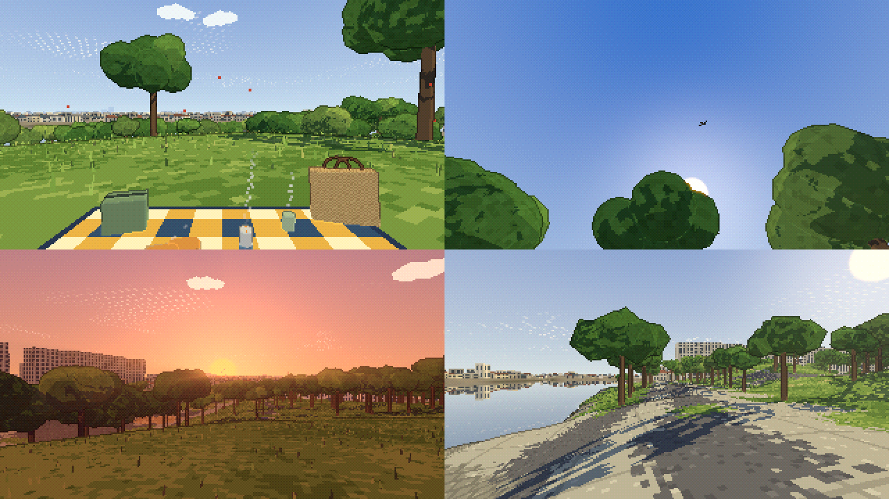
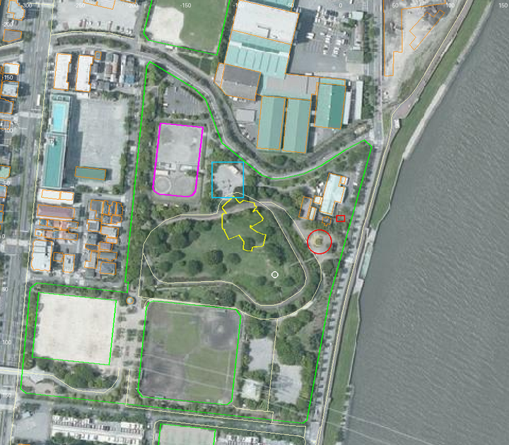
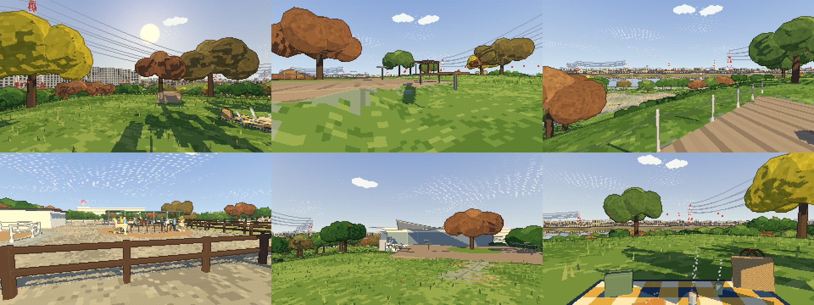

# なぎさ公園（江戸川区 南葛西）— 地形分析・設計・実装の記録

江戸川の場面（[EDOGAWA_DESIGN.md](EDOGAWA_DESIGN.md)）と同じ作り方で、江戸川区 南葛西 7 丁目の なぎさ公園（OSM：総合レクリエーション公園（なぎさ公園））を再現した場面です。

- 作成日：2026-10-18
- ページ：`nagisa.html`（入口ページからも開けます）
- データ：`scenes/nagisa/`（`python3 tools/geo/fetch_data.py --site nagisa` → `python3 tools/geo/build_nagisa.py`）

（左上から ランチ・昼寝・夕日・川辺。320×180 の描画を 2 倍に拡大。2 回目の見直しより前の図）

---

## 1. 場所と地形（データから読んだこと）

| 項目 | 値 |
|---|---|
| 公園の範囲 | OSM の公園の形で 約 6.1 ha（北緯 35.6476〜35.6507、東経 139.8798〜139.8835） |
| 展望の丘 | 頂上 TP 13.5 m（場面の座標 x −61, z 39）。まわりの公園は TP 2〜4 m |
| 旧江戸川 | 公園の東。川幅 約 450 m。水面は TP 0 m（平均海面。東京湾の干満で ±1 m） |
| 護岸 | 川沿いの遊歩道 TP 約 3 m から水面へ。標高データでは 3 m ほどの段差。遊歩道の川側に高さ 1.1 m の胸壁（コンクリートの手すり壁）を、標高データの水際の線（なめらかにして 4 m ごと、1 m 内側）に沿って 93 区間 |
| 木 | 空中写真から 591 本（文学館・馬場・ヤギの囲い・カフェの正面の木を除いたあと。シートのまわり 45 m は 1 本ずつ作って揺らし、残りはまとめて描く） |
| 建物 | 近景のまわり 37 棟（倉庫・家・ポニーの家など。OSM の形と、階数か種類から決めた高さ。屋根の色は空中写真の屋根の色の中央値）＋魔法の文学館、高さ 25 m 以上 129 棟（3 km 以内。下の目立つ建物は除く） |
| 地面の色 | 土・舗装・護岸・道などは、空中写真の色（3×3 でぼかす）を混ぜて塗る（`ground_color.png`）。芝と木は今までの色の表のまま |
| 中景 | 8 m 間隔で 東西 5.4 km × 南北 5.05 km（舞浜・葛西臨海公園まで入るように広げた）。家並みは 2.4 km 以内、500 m より先は遠いほど間引く（約 1.6 万棟） |

**木の見つけ方**：この空中写真では芝と木の色がほとんど同じなので、色だけでは木を拾えませんでした。そこで「緑の所で、5 m 四方の明るさのばらつきが大きい（木の影がまだらになる）か、暗い所」を木とし、屋根や道の縁に出る細い線を「縮めて戻す」処理で消しました。拾った林は 6 m 間隔の木に分けます。

## 1.1 2 回目の見直し（地形・施設の配置）

場面を地図と空中写真に重ねて、ずれと足りないものを洗い出しました。

| 見つけたこと | 直したこと |
|---|---|
| 写真の土・舗装・屋根の色が、どれも同じ灰色・茶色になっていた | 土・舗装・道・護岸の色に空中写真の色を混ぜる。近景の建物の屋根も写真の色に |
| 遊歩道の川側の胸壁がなく、遊歩道から水へそのまま落ちて見えた | 胸壁を作る（水の上にかかる区間・9 m より長い区間は作らない） |
| ツツジ山（約 130 品種 17,000 株）が芝のまま | 丘の芝（TP 5.5〜12.8 m）の中で、写真が暗くまだらな 3 m 四方を植え込みとし、123 か所に低い丸い茂み（10 月なので花はない） |
| 遊具広場に遊具がない | 空中写真の砂の広場（x −105, z −50、30×34 m）に、塔と滑り台・ぶらんこ（6 秒で 1 往復）・うんていを置く。種類と配置は推定 |
| 中景が狭く、舞浜・葛西臨海公園が切れていた | 中景を広げ、霧と描く距離を 5 km まで |
| 川辺の視点は河口の橋の方を向いていたが、川の曲がりで橋が隠れていた | 遊歩道（x 44, z −22）から川下の方位 176° を向く（川面と対岸の家並み・河口の方） |

## 1.2 3 回目の見直し：周囲の詳細な調査（2026-10-19）

原点から 450 m の OSM の要素をすべて（約 4,800）調べて空中写真に重ね、Google マップの名前・空中写真（2026）・来園者の写真、360° 写真 2 か所（展望の丘 2020 年 10 月、川沿いの遊歩道のストリートビュー 2025 年 6 月）を見比べました。

（国土地理院 シームレス空中写真に OSM を重ねたもの。桃：なぎさポニーランドの範囲、黄：魔法の文学館、緑：公園・野球場、橙：建物。赤い丸・四角は前の版のポニーの馬場・ヤギの囲い、水色は遊具広場、白い丸はシート。数字は場面の座標（m））

**大きな間違い**：前の版は、丘の東の丸い広場（x −19, z 8）をポニーの馬場、北東の大きな建物をポニーの家としていましたが、OSM（leisure=horse_riding）・Google マップでは **なぎさポニーランドは丘の北西**（x −176〜−129、z −104〜−34）にありました。丸い広場は **パノラマシャトルの停留所** です。

| 場所 | 調べてわかったこと | 根拠 | 直したこと |
|---|---|---|---|
| なぎさポニーランド | 北に大きな土の馬場（円を描く足跡）、その南に厩舎（黒い屋根と水色の屋根）、土の庭に **白い 2 段の横木の丸い馬場**（半径 約 6.7 m）、東に **茶色の 3 段の木の柵の放牧場**（ポニーが草を食む）、白い門と看板（桃色の文字）、藤棚。ポニーの毛色はいろいろ（薄い金色・ぶち・鹿毛）。ヤギもいる | OSM の範囲、Google マップの空中写真・来園者の写真・口コミ | ここへ移した。白い丸い馬場をポニー 3 頭が周回（乗馬の時間）、土の馬場・厩舎・放牧場（4 頭が草を食む）・門・ヤギの囲い。柵の中には入れない |
| 丸い広場（丘の東） | パノラマシャトル（公園を回る乗り物）の停留所 | Google マップ | 舗装の丸い広場にし、場所の名前を「パノラマシャトル停留所」に |
| 展望の丘 | 頂上は芝で、桜などの木が点々と、刈り込んだツツジの低い植え込み、北北東に黒い木の藤棚、南南西に木のピクニックテーブル。東に川が見える | 360° 写真（2020 年 10 月） | 藤棚とテーブルを足した |
| 川沿いの遊歩道 | 川側に **白いコンクリートの胸壁**（厚さ 約 0.5 m）、アスファルトの遊歩道、内側に刈り込んだ生け垣、その内側に 2 車線の道（旧 新荒川葛西堤防線）と電柱・電線・街灯、その内側が公園 | ストリートビュー（2025 年 6 月）、OSM | 胸壁を白く、高さ 1.4 m・厚さ 0.5 m に。生け垣と、道の公園側に電柱（35 m おき）と電線 |
| 公園の南 | スポーツ広場・野球広場・ゲートボール広場・トイレ・駐車場 | Google マップ、OSM | 地面の色のまま |
| 魔法の文学館 | OSM の階数は 2。公式の紹介では 1 階・2 階の展示だけが書かれ、カフェの階は書かれていない | OSM、紹介記事 | 3 階建て・3 階カフェのまま（7 章） |

## 1.3 実際の写真での見直し（2026-10-20）

園内で撮った写真 9 枚（展望の丘の芝・カフェ・キキのデッキ・デッキから川・ポニーランド 2 枚・丘から北西・丘の東の縁から川・文学館 2 枚）と、Google マップの空中写真（文学館の開館後）を見比べました。

（左上から：丘の芝で南西（逆光）、デッキの西から、☕ デッキの川側の縁、🐴 ポニーの広場、丘から北西（文学館）、🧺 シート。320×180 の描画を 2 倍に拡大）

| 写真でわかったこと | 前の場面 | 直したこと |
|---|---|---|
| カフェ・キキは展望の丘と **同じ高さ** で、南東に濃い茶色の板のデッキ。丸いハイテーブル、真ん中に桜を植えた丸い芝の島、川側の縁にステンレスの柱と鎖の柵、丘の芝の側にベンチ。丘から見ると文学館は 1 階建てのように見える | カフェは丘より 3 m 高い 3 階で、川側に小さな白い手すりのテラス | カフェの床を丘と同じ TP 12.6 m に。空中写真の形のデッキ（地面もならす）と、テーブル 4・芝の島の桜・鎖の柵・ベンチ 2。☕ の視点はデッキの川側の縁から（立ったまま） |
| 文学館の丘の芝に面した壁に、いちご色の枠の大きな窓 | — | 南西を向く壁に、赤い枠と赤い中の窓（夜は少し光る） |
| 乗馬は丸い馬場ではなく、その **東の砂の広場** を、水色のシャツの係の人がポニーを引いて回る。広場の南は茶色の 2 段の横木の柵、奥に白い壁の小屋と白い柱に淡い緑の屋根の日よけ、乗り台。ポニーの毛色はいろいろ（白っぽい金色・栗毛・ぶち） | 丸い馬場をポニー 3 頭が周回。小屋は木の色の箱 | 砂の広場（中心 x −148.5, z −48.5）を 3 頭が周回（ループの継ぎ目でつながるよう同じ毛色）、乗り台の栗毛・順番を待つぶち・丸い馬場の白いポニーは止まって首としっぽを動かす。茶色の柵、白い小屋、淡い緑の日よけ、乗り台。順番を待つ親子は日よけの下へ。ヤギの囲いは広場と重なるので日よけの東へ（位置は推定のまま）。🐴 の視点は広場の南の柵の外から北 |
| ポニーランドの北に、白い鳩の看板（赤と青）のイトーヨーカドー | 家並みに埋もれていた | OSM の平面に高さ 24 m のベージュの箱（駐車場の横の帯）と、西の端の屋上に看板（高さ・大きさは推定） |
| 川の向こう（浦安）とすぐ南西に **紅白の高い鉄塔** と電線 | 鉄塔・電線が無かった（なぎさ公園では読み込んでいなかった） | OSM の鉄塔 11 基・送電線（江東線 27.5 万 V など）を紅白の塗り分けで |
| 対岸の水際に枯れ色のヨシの帯と、鋼の矢板の護岸 | 中景の町の色のまま | 中景の対岸の水際 16 m を「ヨシ」の色に（矢板は細すぎるので省いた） |
| 丘の木は低い所から枝を広げる大きな樹冠（ケヤキ・桜）。10 月下旬で、桜は赤茶に色づいて葉が少なく、ほかは緑に黄色が混じる。イチョウが 1 本黄色 | 細い幹に丸い樹冠、桜は橙色で多い | 樹冠を傘形に（`createForest` の `crown: 'spread'`）。桜の割合を 30 → 16 %、秋の桜は赤茶と黄土色に（全場面）。イチョウを 6 % 混ぜる（秋は黄色） |

確かめたこと：読み込みのエラーなし（ほかの場面も）。🧺・☕・🐴 の視点で t と t + 6 秒の描画が全画素一致。描画の時間 2.8 ms（前は 2.0 ms）。

## 2. 遠くに見えるもの（展望の丘から）

| 物 | 方位 | 距離 | 作り方 |
|---|---|---|---|
| 葛西臨海公園の大観覧車（ダイヤと花の大観覧車） | 256° | 2.4 km | 形を作って実際の位置に立てる（高さ 117 m・直径 111 m・ゴンドラ 68 台。公表値）。夜は輪が 6 秒で色を変えて光る |
| 富士山 | 253° | 109 km | 影絵（地球の丸みで 約 810 m 隠れ、見える高さ 約 2,960 m、見かけ 1.5°） |
| 東京タワー | 275° | 12.5 km | 影絵 |
| 東京スカイツリー | 316° | 9.4 km | 影絵 |
| 河口の橋（首都高湾岸線・東京湾岸道路（国道 357 号）・JR 京葉線） | 160〜230° | 1.2〜1.4 km | 橋（桁）として実際の線の上に。京葉線の電車（ワインレッドの帯）と車が走る |
| 北の橋（葛西橋通り・東京メトロ東西線） | 5〜15° | 1.6〜1.9 km | 同上。東西線の電車（水色の帯） |
| 東京ディズニーリゾート（舞浜） | 160〜200° | 2〜2.7 km | 家並み・ホテル（高さ 25 m 以上の建物）と、下の 2 つ |
| シンデレラ城 | 174° | 1.9 km | 高さ 51 m（OSM）。石の土台・白い本体・青い円すいの屋根の塔（中央と四隅）。形は簡略で、意匠は描かない |
| プロメテウス火山 | 177° | 2.6 km | 高さ 51 m（OSM）。赤茶色の岩山（裾の直径 150 m は推定）と火口 |
| 葛西臨海水族園 | 242° | 2.2 km | 高さ 9.7 m の本館の上のガラスドーム（頂部 30.7 m、紹介記事）。骨組みを 1 ドットの線で。夜はドームが光る |
| クリスタルビュー（葛西臨海公園） | — | 約 2 km | OSM の平面のガラスの建物（高さ 11 m は推定）。夜は明かり |
| 東京ゲートブリッジ | 約 215° | 約 6 km | 影絵（OSM の線の点ごとの方位と距離。中央 440 m はトラスの山形で頂部 約 88 m、ほかは桁 約 55 m）。「恐竜橋」の形 |

**見え方の注意**：城・火山・水族園のドームは実際の位置と高さに置いてありますが、公園の視点からは、手前の木と対岸の家並みに隠れてほとんど見えません（夕日・川辺・カフェの視点で、置いた場合と置かない場合の描画の差は 0〜3 画素）。北の胸壁のあたりから南を見ると、舞浜のホテルが 100 画素ほど見えます。現地でも、木の多い公園の中からは見えにくいはずです。

**夕日**：2026-10-18 の日の入りは方位 258° 前後。展望の丘から見ると、大観覧車（256°）のすぐ右に沈み、富士山（253°）はその左です。

## 3. 視点（ボタン・1〜4 キー）

視点は、木と建物の高さを見積もって「どの向きが遠くまで見通せるか」を計算して決めました（`build_nagisa.py` の `Sight`）。☕ と 🐴 は ⚙️ メニューの「寄り道」にあります（5・6 キー）。

| ボタン | 時刻 | 位置と向き | 見通し |
|---|---|---|---|
| 🍲 ランチ | 12:00 | 展望の丘の頂上の芝生にシート（南西 6 m に木）。方位 120° | 600 m 以上 |
| 😴 昼寝 | 13:30 | シートに寝ころび、南西の木の方を見上げる（55°）（2026-10-20 から 😴 寝っ転がる：その場で寝そべるだけ。場所・時刻は変えない） | — |
| 🌇 夕日 | 16:51 | 丘の上（x −68, z 46）から大観覧車の方位 | 600 m 以上 |
| 🌊 川辺 | 15:00 | 旧江戸川沿いの遊歩道（x 44, z −22）から、川下の方位 176°（川面・対岸・河口の方。橋は川の曲がりで隠れる） | — |
| ☕ カフェ・キキ | 14:00 | カフェ・キキのデッキ（展望の丘と同じ TP 12.6 m）の川側の縁から、旧江戸川の方位 106°（1.3 節） | 川の向こうまで |
| 🐴 ポニーランド | 10:45（乗馬の時間） | 砂の広場の南の柵の外から北：周回するポニー、白い小屋・淡い緑の日よけ、奥にイトーヨーカドー（1.3 節） | — |

## 4. 公園の施設（調べたことと、作り方）

ウェブの公式の案内・紹介記事と、OSM・空中写真から調べました。

| 施設 | 調べてわかったこと | 場面での作り方 |
|---|---|---|
| **魔法の文学館（江戸川区角野栄子児童文学館）** | 2023 年 11 月 3 日開館。設計 隈研吾建築都市設計事務所。なぎさ公園の丘に建つ純白の建物で、花びらが広がるような屋根「フラワールーフ」。1 階 コリコの街・図書、2 階 アトリエ、**3 階 カフェ・キキ（旧江戸川を一望できる見晴らしのよい空間）**。延床 1,613.95 m²。館内は「いちご色」 | OSM の平面（花の形、42×51 m）を丘の北の斜面に。白い壁、3 階はガラスの帯（夜は館内のいちご色が透ける）、平面の張り出した角ごとに外へ反り上がる白い花びらの屋根（7 枚、軒の出 4 m）。川側にカフェのテラス（床 TP 15.9 m）と手すり |
| **なぎさポニーランド** | 公園の一画。ポニーに無料で乗れる（小学 6 年生以下）。乗馬は 10:00〜11:30 と 13:30〜15:00（夏は午前のみ）、月曜休み。ポニーの家でふれあい、ヤギのふれあいコーナーもある。区の資料では なぎさの馬は 8 頭。**ポニーは柵の中の馬場を周回する**（お知らせいただいた様子） | 空中写真の明るい輪から、馬場の中心（x −19, z 8）と大きさ（走路 半径 3.5〜11 m）を測った。外の柵は縦の格子（檻のような柵、高さ 1.3 m、門 1 か所）、内側に低い柵、中央に八角の小屋根。ポニー 5 頭が引き手に連れられて反時計回りに並足で周回（約 1.6 m/s、乗る子どもつき）。乗馬の時間だけ周回し、ほかの時間は輪の上で休む。門の前に順番を待つ親子 |
| **ポニーの家** | 公式の案内に名前のみ | 1.2 節で、ポニーランドの土の馬場の南の厩舎に直した（前は公園の北東の建物と読み違えていた） |
| **ヤギのふれあいコーナー** | ヤギがいて、なでられる | 低い木の柵（8×6 m）と白いヤギ 2 頭（草を食べるように首を上下）。**位置は推定**（1.2 節でポニーランドの中へ移した） |
| 展望の丘 | 海抜 13 m で旧江戸川が望める | 標高データの丘（TP 13.5 m）のまま |
| ツツジ山 | 約 130 品種 17,000 株 | 空中写真の暗いまだらから 123 か所の茂み（各 3 つの丸い塊）。10 月なので花はない |
| 野球広場・スポーツ広場 | 少年用の野球広場、サッカーなどの広場 | OSM の範囲と空中写真の地面の色のまま |
| 遊具広場 | 公式の案内に名前のみ | 空中写真の砂の広場に、塔と滑り台・ぶらんこ・うんてい（推定） |
| 川沿いの遊歩道 | 旧江戸川に沿う | 標高データの水際に沿って胸壁 |

**写真より新しいもの**：空中写真は文学館の開館（2023 年）より前のもので、文学館の場所には芝と木が写っています。文学館の平面と、そのまわりの木は除きました。さらに、カフェが「旧江戸川を一望できる」とされているので、カフェの正面（左右 35°・40 m 以内）でテラスの目の高さより高くなる木 5 本を除きました。

**ポニーのループ**：5 頭を同じ姿（栗毛・赤い鞍、緑の上着の引き手、黄色い服に白い帽子の子ども）にし、6 秒でちょうど 1 頭分進むので、ループ動画の継ぎ目でつながります（脚は 6 秒に 8 歩）。

## 5. エンジンに足したもの

| 部品 | 内容 |
|---|---|
| `engine/trees.js` | 木と木漏れ日（ピクニックの作り方を共通の部品にしたもの）。近くの木は 1 本ずつ揺らし、遠くの木はまとめて描く。どちらも影に葉のすき間があく |
| `engine/structures.js` の `createFerrisWheel` | 大観覧車。6 秒でゴンドラ 2 つ分まわる（ループ動画でつながる）。遠くでは部材が 1 ドットより細くなって消えるので、輪・スポーク・脚を 1 ドットの線、ゴンドラを点でも描く |
| `engine/backdrop.js` | 影絵の種類に「鉄骨の塔（東京タワー）」「山（富士山、山頂に薄く雪）」を追加。逆光ではより暗い影絵に。影絵の輪の高さを目の高さに合わせる（丘の上から見ても沈まない） |
| `engine/terrain.js` の `photoMix` | 地面の種類ごとに、空中写真の色を混ぜる（色の表で `photo: true` の種類だけ。江戸川は写真の色を持たないので変わらない） |
| `engine/backdrop.js` の `profile` | 点ごとに方位・距離・高さを持つ影絵（東京ゲートブリッジ） |
| `engine/structures.js` の `createHouses` の `thinFrom` | この距離より先の家を、遠いほど間引く（最少 12%） |
| `realsite/nagisa-surroundings.js` | シンデレラ城・プロメテウス火山・水族園のドーム・クリスタルビュー、ゲートブリッジの影絵 |
| `realsite/nagisa-facilities.js` に追加 | 胸壁（`createSeawall`）・遊具（`createPlayground`）・ツツジの茂み（`createAzaleas`） |
| `engine/pixel-renderer.js` の `prepareShadows()` | 水面の反射・屈折を描く前に影を更新する（前は 1 コマ前の影を使っていて、ループの継ぎ目でわずかにずれていた） |
| `realsite/`（旧 `edogawa/`） | 持ち物・生き物・色の表を、江戸川となぎさ公園で共有。生き物に カモメ（ユリカモメ）、電車に 京葉線・東西線、車を走らせる橋・船の通り道を場面ごとに指定できるように |
| `tools/geo/` | `--site nagisa` で場所を切り替え。キャッシュは `cache/<場所>/`、出力は `scenes/<場所>/` |

ほかに、2 つの場面の毎フレームの処理で次を直しました（江戸川にも反映）。
- 周期で繰り返すもの（湯気・生き物・木の揺れ・木漏れ日）には、6 秒で折り返した時刻を渡す（シェーダーの小数の誤差で継ぎ目がわずかにずれないように）。
- カメラの行列を、動かした直後に更新する（太陽の光の筋が、視点を移した直後の 1 コマだけずれていた）。
- 影の中心をカメラに合わせてから光を置く。

## 6. 確認したこと

| 確認 | 結果 |
|---|---|
| ループの継ぎ目（電車・車・船を止めた状態） | 3 回目の見直しのあとも 6 視点とも全画素一致。2 回目の見直しのあと、ランチ・昼寝・夕日・川辺・カフェ・ポニーランドの 6 視点で、t と t + 6 秒の描画が全画素一致（2 つの時刻で確認）。半周期ずらすと 2,100〜9,500 画素が違う（動いている） |
| 速さ | 1 コマ ランチ 3.9・昼寝 2.3・夕日 3.6・川辺 2.9・カフェ 4.1・ポニーランド 3.3 ms（3 回目の見直しのあと。GPU の待ちを含む）。いちばん重いのはカフェの視点（高い所から公園の木をほぼすべて見渡すため） |
| 大観覧車 | 15:00 の夕日の視点で、霞んだ白い輪として見える。夕日の時刻は太陽のちょうど手前に重なり、影絵になる |
| 江戸川・ピクニック・街 | 2 回目の見直しのエンジンの変更のあとも、エラーなし。江戸川のループの継ぎ目は 4 視点とも全画素一致、1 コマ 0.8〜1.7 ms |

## 7. わかっていないこと・割り切ったこと

- **富士山**は丘の上からでも見かけ 1.5° と低く、夕日の視点では遠くの木々の上端に隠れて、ほとんど見えません（現地でも空気が澄んだ日に限られるはず）。
- **大観覧車の車輪の向き**は不明なので、公園の方を向けています。
- **木の高さ**は空中写真の樹冠の大きさから見積もった値（樹冠の半径 r に対して 高さ 1.6 + 1.8r m）。実際の樹種・高さは確かめていません。
- **ディズニーリゾート**の城・火山は高さ（OSM）と位置だけが確かで、形は簡略です（ロゴ・意匠は描きません）。公園の視点からはほぼ隠れます。
- **水族園のドームの直径**（約 76 m）、**クリスタルビューの高さ**（11 m）、**ゲートブリッジの高さ**（頂部 88 m・桁 55 m）は推定です。
- **ツツジの茂み**は空中写真の暗いまだらから拾ったもので、植え込みの実際の範囲は確かめていません。**遊具の種類と配置**も推定です。
- 近景の建物は OSM にあるものだけ（38 棟）。OSM に無い建物は地面の色（舗装・屋根）でしか表れません。
- **文学館の高さ・屋根の枚数・テラスの位置**は公表値が見つからず、推定です（3 階建て、カフェの床は平面の中の地面の平均 + 8.5 m、花びらは平面の張り出しの数）。カフェの視点は、川の方を向き 300 m 以上見通せる東の縁に置きました。
- **ポニーランドの配置**（1.2 節）は Google マップの空中写真の画素から読んだもので、大きさは推定です。乗馬が白い丸い馬場か大きな土の馬場かは、写真からは決めきれず、丸い馬場にしました（前の版の円の位置は間違いでした）。
- **魔法の文学館の階数**：OSM では 2 階建て。場面は 3 階にカフェのテラスのまま（公式の階の記載が見つからない）。
- 川沿いの胸壁は、ストリートビューでは目の高さに近く見えます。場面では川が見えるように 1.4 m にしました。
- 〔前の版の記述〕馬場の形（円）と大きさは空中写真の明るい輪から測りました。実際の走路の形・柵の色・ポニーの頭数（区の資料では 8 頭。場面では周回する 5 頭）・毛色は確かめていません。
- **ヤギのふれあいコーナーの位置**は推定です。
- パノラマシャトル（園内を走る乗り物）とハーブ園は作っていません（ハーブ園は位置がわかりませんでした）。
- 書き出し（📷）は江戸川と同じ仕組みですが、実際のファイル保存はこの作業では試していません。

## 8. 出典（施設の調査）

- 江戸川区「なぎさ公園」：https://www.city.edogawa.tokyo.jp/e066/kuseijoho/gaiyo/shisetsuguide/bunya/koendobutsuen/c_recreation/nagisa.html
- 江戸川区「なぎさポニーランド」：https://www.city.edogawa.tokyo.jp/e066/kuseijoho/gaiyo/shisetsuguide/bunya/koendobutsuen/nagisaponyland.html
- るるぶ＆more「なぎさポニーランド」：https://rurubu.jp/andmore/spot/80012301
- いこーよ「なぎさポニーランド」：https://iko-yo.net/facilities/3100
- architecturephoto「隈研吾による、東京・江戸川区の“角野栄子児童文学館”」：https://architecturephoto.net/192004
- Wikipedia「江戸川区角野栄子児童文学館」：https://ja.wikipedia.org/wiki/江戸川区角野栄子児童文学館
- 東京ディズニーリゾート 公式・OSM（シンデレラ城 way 217727348、プロメテウス火山 node 859682628 の高さ）
- 東京都公園協会「葛西臨海水族園」・紹介記事（ドームの高さ 30.7 m、谷口吉生設計）
- 東京都港湾局「東京ゲートブリッジ」（トラス橋、全長 2,618 m）
- Google マップ（なぎさポニーランドの場所・空中写真・来園者の写真・口コミ、パノラマシャトル停留所、展望の丘の 360° 写真、遊歩道のストリートビュー）：見た様子を参考にした（画像は使っていない）
- 地図データ © OpenStreetMap contributors（文学館の平面 way 1220677132、なぎさポニーランドの範囲 way 536919774、旧 新荒川葛西堤防線 way 796894975、クリスタルビュー way 161731857、東京ゲートブリッジ way 150870020・150870021 ほか）
